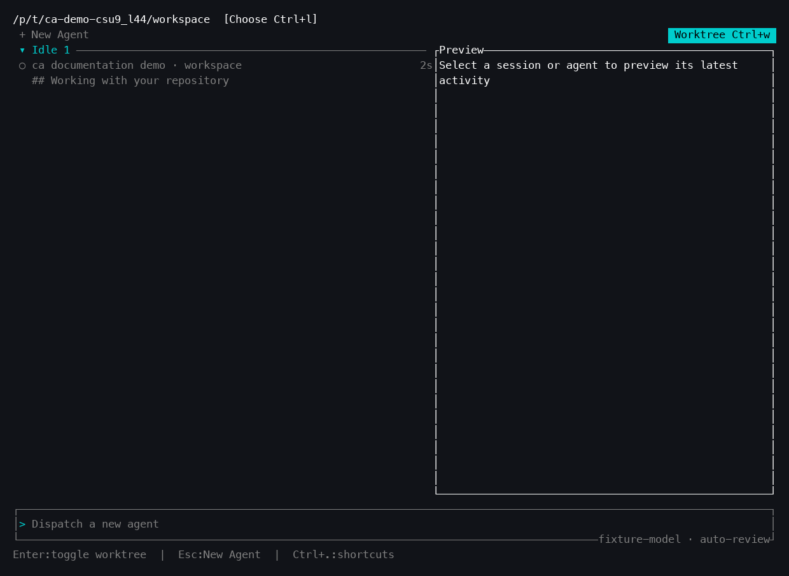
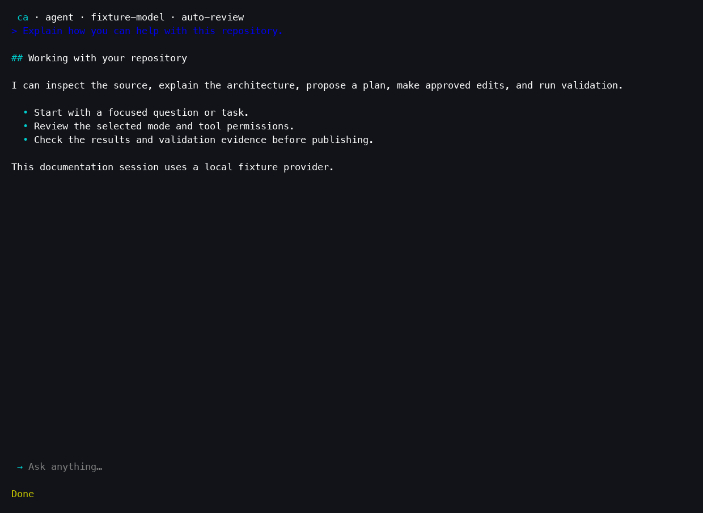
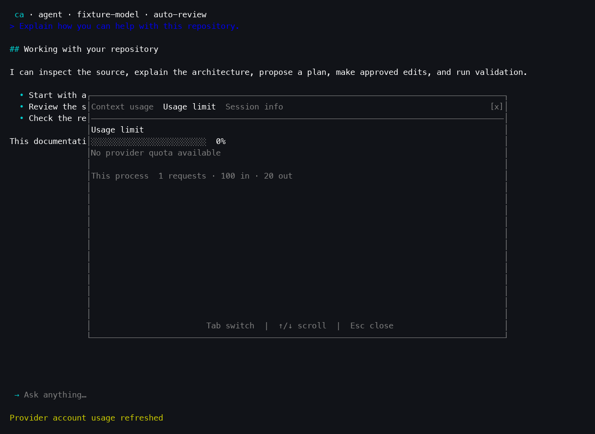
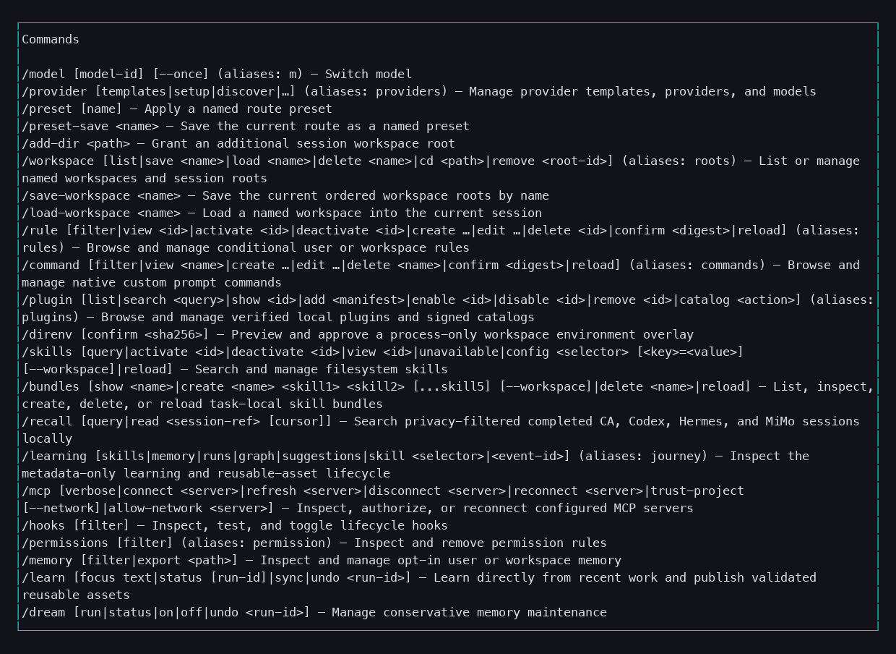

# ca

`ca` is a Rust terminal coding agent with interactive conversations, configurable
model providers, local tools, durable sessions, and native automation. It uses
ratatui, crossterm, and Tokio. The application runs as a terminal UI, a headless
command, a versioned JSONL service, or an ACP v1 stdio agent.

## Start here

```sh
git clone https://github.com/ajzrva-sys/ca.git
cd ca
cargo build --release --workspace --all-features --locked
# On macOS, sign locally before executing:
codesign --force --sign - target/release/ca
./target/release/ca --version
./target/release/ca --help
```

Configure a provider using [the configuration guide](docs/CONFIGURATION.md), then
launch `ca` in the directory you want to work on. An explicit headless prompt
runs without opening the terminal UI:

```sh
ca --prompt "Explain this repository" --auto-review
ca --continue
ca --resume-list
ca dashboard
```

## Capabilities

- Interactive Agent, Ask, Plan, and Debug workflows, plan review, streaming
  output, tool approvals, and interruptible turns.
- Chat Completions, Responses, Anthropic Messages, and native Gemini adapters selected per
  configured provider; configurable models, routing, and explicit fallbacks.
- Workspace-aware file and command tools, Git review, managed worktrees,
  deterministic tool discovery, and bounded concurrent native reads.
- Saved sessions, compaction, branches, bookmarks, checkpoints, durable edit
  recovery, and session writer ownership across processes.
- Filesystem Agent Skills, MCP, LSP, hooks, plugins, local model runtimes,
  optional retrieval, and local learning workflows.
- Durable scheduled tasks and automations with budgets, typed receipts,
  cancellation, reconciliation, and reviewed repository publication.
- Headless text/JSON/JSONL output, JSON Schema checks, explicit verification,
  JSONL service transport, and stable ACP v1 interoperability.

Capabilities require their configured runtime, credentials, permissions, or
optional dependencies. A listed feature does not imply access to a hosted
service or an enabled integration.

## Documentation

| Guide | What it covers |
|---|---|
| [Getting started](docs/GETTING_STARTED.md) | Prerequisites, build, install, first run |
| [FreeBSD](docs/FREEBSD.md) | Native build, shared jail service, required isolation |
| [Configuration](docs/CONFIGURATION.md) | Providers, credentials, profiles, policy |
| [User guide](docs/USER_GUIDE.md) | Interactive and headless work, sessions, extensions |
| [Automation](docs/AUTOMATION_GUIDE.md) | Scheduled work, native typed engine, recovery |
| [Development](docs/DEVELOPMENT.md) | Workspace map, validation, contribution boundaries |
| [Troubleshooting](docs/TROUBLESHOOTING.md) | Build, provider, terminal, session, automation problems |
| [CLI reference](docs/CLI_REFERENCE.md) | Help captured from the release executable |
| [Publication validation](docs/PUBLICATION_VALIDATION.md) | Current release evidence and historical publication results |
| [Knowledge index](docs/.INDEX.md) | Detailed engineering and feature records |
| [Architecture](ARCHITECTURE.md) | Module ownership and invariants |
| [Service protocol](docs/SERVICE_PROTOCOL.md) | JSONL transport contracts |

## TUI screenshots

Captured from the signed release executable in a 120 × 36 terminal. The demo
uses a disposable local fixture provider and sample text.





| Usage panel | Command help |
|---|---|
|  |  |

See [the screenshot gallery](docs/SCREENSHOTS.md) for full-size captures and
reproduction details.

## Workspace

The root `ca` application integrates `ca-watch`, `ca-automation`, and
`ca-automation-protocol`. `codex-team` and `codex-team-protocol` remain compatibility
packages. The `planner-executor-experiment` feature additionally enables the
reasoning-artifact experiment binary; it is an experimental path.

This initial Git import includes application source, fixtures, tools, and
engineering documentation. Local build output, scratch receipts, runtime state,
and oracle/reference archives are excluded. Historical engineering records may
refer to those local archives and dated absolute paths. They are retained as
history; the guides above describe the portable source checkout.

## Status and distribution

Version: `0.1.41`. See [publication validation](docs/PUBLICATION_VALIDATION.md) for
the checks actually run. Historical validation is recorded in [TESTING.md](TESTING.md).
Long-duration soak tests and selected real-model retrieval checks are separate
from compiling and running the offline test suite.

## License

CA-owned code, documentation, prompts, schemas, tests, tools, and screenshots
are available under either the [MIT License](LICENSE-MIT) or the
[Apache License, Version 2.0](LICENSE-APACHE), at your option.

Third-party components retain their own licenses and notices; this choice does
not relicense them. See [third-party notices](THIRD_PARTY_NOTICES.md),
[licensing scope and unresolved provenance](docs/LICENSING.md), and
[contribution terms](CONTRIBUTING.md). Existing MIT grants remain available.
