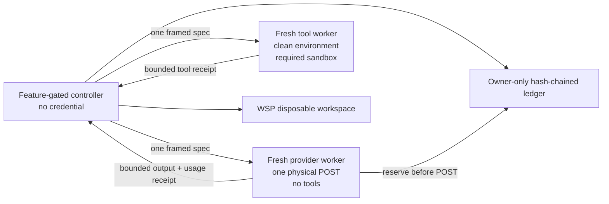

# Capability Expansion Execution Handoff

Status: READY FOR SERIAL CONTINUATION; `SKL-098` IS NEXT
Prepared: 2026-08-12
Sequence: `WSP-096` → `RND-097` → `SKL-098` → `SCH-099` → `EML-100` → `EML-101`

## Purpose

This document is the implementation handoff for the accepted capability-expansion program. WSP-096 and RND-097 are complete; a new executor should create and complete SKL-098 and each remaining ExecPlan one at a time without rediscovering ownership, compatibility boundaries, or security invariants.

Only one plan may be active. Finish, validate, document, and archive the current plan before copying the next plan contract from this handoff into `docs/exec-plans/active/` and linking it from `NEXT_STEPS.md`.

## Read and Execution Order

Before editing, read in this order:

1. `AGENTS.md`
2. `docs/.INDEX.md`
3. `CONTINUITY.md`
4. `ARCHITECTURE.md`
5. `PARITY.md`
6. `TESTING.md`
7. `NEXT_STEPS.md`
8. `.agent/PLANS.md`
9. the one active ExecPlan
10. this handoff

At every resume point:

1. Re-run `git status --short`, but use it only as a safety signal.
2. Read the active plan and this handoff's matching section.
3. Inspect the named symbols before editing because line numbers can drift.
4. Record an explicit touched-file list before the first edit.
5. Complete one numbered packet, run its focused test, and update the active plan before taking the next packet.
6. Never begin a later capability to work around an unfinished predecessor.

## Repository State and Attribution Warning

At handoff time, `git ls-files` returns zero and `git status --short` reports the entire checkout as untracked. There is no usable committed baseline. Therefore:

- never run `git clean`, `git reset`, `git checkout --`, or blanket staging;
- never infer ownership from `git diff` or untracked status;
- maintain a written touched-file manifest in the active ExecPlan;
- use file hashes, focused source inspection, and test results to identify the live state;
- preserve `.DS_Store`, `.agent/`, local harness files, and every unrelated path unless the active packet explicitly owns it;
- keep `oracles/` and `reference/` read-only.

Recovery update (2026-08-13): the primary source, tests, plans, and project documentation now have a root baseline. `target/`, `.mimocode/`, `oracles/`, and `reference/` remain local and excluded from that root repository. The historical cautions above still explain pre-baseline attribution, while future packets may use Git diff/status together with the required touched-file manifest.

## Program-Wide Invariants

- No plan may print, persist, or pass a credential through controller JSON, command arguments, logs, Debug output, snapshots, test fixtures, or model-visible tool output.
- No benchmark or scheduled mutation may execute in the main checkout. Mutating work uses the completed WSP-096 disposable-workspace boundary.
- No feature may grant itself network, path, process, MCP, skill, mailbox, scheduling, or external-communication authority.
- Generic network approval and `--yolo` never authorize email sending.
- Skills are instructions and resources, not authority. Reading a script never executes it.
- Scheduled and gateway jobs cannot use ambient interactive skills; they require exact instance and digest declarations.
- Email input is untrusted data. It cannot approve tools, create schedules, invoke external actions, or enter ordinary sessions/memory/hooks/checkpoints.
- A crash after an externally visible action with no durable acknowledgement is ambiguous. Do not retry that action automatically.
- No normal implementation step installs a binary, installs/removes a LaunchAgent, mutates user runtime state, commits, pushes, edits an oracle, or performs live mailbox traffic.
- User-visible claims require focused behavior tests. Build success alone is not acceptance.

## Serial Status

| Plan | Status at handoff | Hard dependency |
|---|---|---|
| `WSP-096` | COMPLETE and archived | none |
| `RND-097` | COMPLETE and archived; paid sample blocked before traffic by absent canonical route | WSP-096 |
| `SKL-098` | next contract; not yet active | archived RND-097 |
| `SCH-099` | contract below; not yet active | archived SKL-098 |
| `EML-100` | contract below; not yet active | archived SCH-099 |
| `EML-101` | contract below; not yet active | archived EML-100 |

## Immediate Resume Card for the Next Executor

Create `docs/exec-plans/active/skl-098-agent-skills-compatibility.md` from the
SKL-098 contract below and link it from `NEXT_STEPS.md`. Preserve RND-097's
feature-gated broker/tool separation, exact ledger, WSP isolation, and zero
ordinary-runtime effect; its paid sample remains externally blocked and is not
a reason to reopen the completed implementation.

## Completed Foundation: WSP-096

`docs/exec-plans/completed/wsp-096-cow-workspace-materialization.md` is the source of truth. Do not reopen or replace its walker.

The reusable API is in `src/workspace_materialization.rs`:

- `MaterializationPolicy::{benchmark, scheduled}`
- `ClonePreference::{PreferClone, CopyOnly}`
- `ScheduledTrackedAllowlist::new`
- `materialize_workspace`
- `materialize_scheduled_workspace`
- `DisposableWorkspace::{path, receipt, workspace_id, verify_recovery_artifact, reopen, cleanup_after_export}`
- `VerifiedRecoveryArtifact::{final_manifest_sha256, artifact_sha256, artifact_size}`

Important caller responsibilities:

- WSP admission is process-local; SCH-099 must add cross-process leases and byte reservations.
- WSP verifies an external recovery artifact's identity and stability, not semantic completeness. RND-097 and SCH-099 must independently prove that applying/extracting the artifact reconstructs the final manifest before cleanup.
- Materialized workspaces deliberately have no `.git` and reject build/cache output. Set `CARGO_TARGET_DIR` outside every disposable workspace.
- Benchmark mode rejects all symlinks/hardlinks/special files. Scheduled mode accepts only its exact tracked allowlist and safe in-root relative symlink graph.
- Published workspaces survive handle drop. Cleanup is explicit, capability-bound, and retryable.

The last recorded WSP gates were 22 focused tests, 1152 unit tests plus one ignored, 36 CLI tests, formatting, strict Clippy, release build, help/version, and zero pending snapshots.

# RND-097 — Completed Capped OpenAI Pilot Harness

Completed plan: `docs/exec-plans/completed/rnd-097-openai-planner-executor-pilot.md`

## Frozen Experiment Contract

- 72 target trials: six fixtures × six arms × two repetitions.
- Fixtures: `unicode_parser_boundary`, `permission_scope_matching`, `protocol_tool_interleave`, `atomic_journal_recovery`, `process_timeout_cleanup`, `config_migration`.
- Arms: `S0`, `C0`, `SS`, `SC`, `SP`, `SC-G`.
- The first six slots are fixture `unicode_parser_boundary`, repetition one, across all six arms in the preregistered balanced order. They are the included calibration; there are no additional paid calibration calls.
- Routes: canonical `openai` / OpenAI Responses, `gpt-5.6-sol` and `gpt-5.6-luna`, both high effort, default service tier, `store=false`.
- Never use `previous_response_id`, never deliberately warm prompt caches, and never transfer opaque provider continuation state between phases or models.
- Per physical request: 64,000 maximum input tokens and 8,192 maximum output tokens.
- Planner: one semantic request. Executor: at most 12 semantic requests, 40 tools, ten minutes. Recovery: at most eight semantic requests and 24 tools.
- One retry is permitted only for a verified pre-output transport failure. Every physical POST, including that retry, needs its own durable reservation.
- Local hard cap: USD 50.00, expressed as exact atto-USD. Unknown/invalid/missing usage consumes the full reservation.
- The result is an underpowered descriptive pilot. It cannot enable production routing.

`SC-G` routes to Sol before execution iff the validated artifact contains an unresolved decision, protocol/persistence/concurrency/migration risk, more than three affected files, or inadequate required-gate coverage. Otherwise it routes to Luna. It may make one Sol recovery only after a deterministic verifier failure.

`SP` performs its own Sol planner call. The controller converts that structured artifact to deterministic prose within ±2% UTF-8 bytes without adding task information. Randomized order must not make SP depend on another arm's result.

## Historical Implementation Record

### Provider and usage lane — implemented and focused-green

Behavioral files:

- `src/agent/stream.rs`
- `src/agent/client.rs`
- `src/agent/provider.rs`
- `src/agent/client_tests.rs`
- `src/usage.rs`

Mechanical literal compatibility additions also exist in `src/main.rs`, `src/goal.rs`, `src/headless.rs`, `src/service.rs`, `src/multi_run.rs`, and `src/tui/render_tests.rs`.

Implemented behavior:

- `UsageInfo.cache_write_tokens` and bounded/redacted `ProviderResponseMetadata`;
- exact Chat/Responses/Anthropic cache-read, cache-write, and reasoning parsing;
- cache-write pricing with checked disjoint usage validation;
- optional Responses `max_output_tokens`, `store`, and service tier fields that preserve ordinary request bytes when absent;
- `ProviderCallPolicy::one_attempt()` and a caller-selectable policy constructor;
- official `X-Client-Request-Id` support only for one-attempt Responses requests;
- returned `x-request-id` domain-hashed before retention, plus response model/tier conflict checks.

Recorded focused results: provider 25, client 36, stream 12, and usage 7 passed; `cargo test --no-run`, formatting, and default strict Clippy passed at that checkpoint.

### Protocol lane — R1 complete and focused-green

`src/reasoning_experiment_protocol.rs` is imported by both `ca` under the
experiment feature and `ca-reasoning-artifact-experiment`. It now has strict
`ProviderCallSpecV1`, `ProviderCallReceiptV1`, `ToolCallSpecV1`, and
`ToolCallReceiptV1` types; canonical bounded length-prefixed JSON frames;
nonce/payload digest binding; frozen Responses body options; exact receipt
model/tier/usage validation; and redacted Debug output. Eight focused protocol
tests and feature strict Clippy pass.

Useful phase/controller types already present include `ExperimentArm`,
`ExperimentPhase`, `ExperimentModelRouteV1`, `ExperimentRequestLimitsV1`,
`ExperimentWorkerSpecV1`, `ExperimentWorkerReceiptV1`, `ExperimentUsageV1`,
`ExperimentProviderReceiptV1`, reservation/grant/settlement control types, and
frozen model/limit constants.

Do not stabilize or use the current phase-level worker protocol as a provider
process contract. The accepted topology requires:

- a controller-owned semantic loop;
- one hidden provider process accepting exactly one digest-bound physical Responses call and executing no tool;
- one clean tool process accepting exactly one exact tool request and loading no provider/config credential;
- separate bounded `ProviderCallSpecV1`/`ProviderCallReceiptV1` and `ToolCallSpecV1`/`ToolCallReceiptV1` frames;
- distinct reservation request, grant, and settlement schema constants;
- versioned, length-prefixed canonical JSON framing, nonce/hash binding, frame caps, and explicit inherited-descriptor/CLOEXEC rules.

### Fixture lane — offline R0 wiring complete

Present paths:

- `src/bin/reasoning_artifact_experiment/fixtures.rs`
- six baseline crates under `tests/fixtures/reasoning_pilot/`
- six golden crates under `tests/reasoning_pilot_golden/`
- hidden verifier under `tests/reasoning_pilot_hidden/`

`src/bin/reasoning_artifact_experiment.rs` now imports the module and exposes
offline `fixture-check --repo ROOT`. It emits deterministic pretty JSON and
returns nonzero after emitting a failing receipt. The last feature-bin run
passed 65 tests with one intentionally ignored fixture unit; the real CLI check
accepted all 12 WSP-materialized candidates and exited zero. Expected hidden failure codes are
`unicode_mid_scalar`, `component_prefix_escape`, `interleaved_call_state`,
`partial_tail_recovery`, `descendant_survived_timeout`, and
`legacy_config_rejected`.

R5 replaces the feature binary's fixture-private-copy boundary with WSP-096
benchmark materialization, external Cargo targets, a bound no-op recovery
artifact, and explicit cleanup. The full 12-candidate suite is green under
session-isolated verifier workers; do not report the historical private-copy
sweep as WSP coverage. The no-op proof remains sufficient only for the
checker: actual benchmark trials still need a complete patch/archive
reconstruction proof.

### Spend-ledger lane — R2 price-card core complete

`src/reasoning_experiment_ledger.rs` is feature-gated from `ca` and shared into
the experiment binary. It implements exact unsigned atto-USD, an owner-only
Unix ledger root, no-follow files/directories, one immutable event file per
sequence, canonical-JSON SHA-256 chaining, durable reserve/settle/unknown/
verified-pre-send release transitions, duplicate physical-request rejection,
and cap accounting across settled, unknown, and outstanding amounts. Its
immutable header stores a validated dated price card and digest; every
provider-call binding carries that digest. Reservation uses the maximum legal
input and output rate; settlement computes exact cost from five disjoint usage
categories.

Twelve focused tests pass: exact money, normal transitions, cap accounting,
duplicate request rejection, tamper/truncate/reorder refusal, temp cleanup,
concurrent reservation serialization, widened/symlink root refusal, frozen
Sol/Luna worst-case and disjoint usage math, one-call reservation identity,
and persisted price-card tamper refusal. R2 remains incomplete until controller
and provider processes share this authority safely and resume state makes every
outstanding/unknown attempt explicit.

### Experiment clean-environment lane — sandbox gate complete

Partial behavior exists in `src/jobs.rs`, `src/sandbox.rs`, `src/agent/registry.rs`, `src/agent/tools.rs`, and `src/tool_selection.rs`, with mechanical new sandbox fields in several callers.

The clean policy clears the environment, supplies private `HOME`, `CARGO_HOME`, `CARGO_TARGET_DIR`, fixed locale/time values and offline Cargo, denies network and process inspection, and exposes only selected read-only toolchain roots. Secret and `/bin/ps e` sentinel coverage is green.

The following four focused regressions pass under the feature build:

```text
cargo test --bin ca --features planner-executor-experiment \
  experiment_sandbox_ -- --nocapture
# PASS: sandboxed offline stdlib Cargo, parent-env denial, host-HOME denial

cargo test --bin ca --features planner-executor-experiment \
  macos_sandbox_denies_loopback_unless_network_is_granted -- --nocapture
# PASS
```

The minimal macOS profile retains blanket process and sysctl denial but allows
only self process identity and `hw.pagesize_compat` for Rust's stack guard
page. It also grants only read access to public toolchain locations and a
literal `/dev/null` write target; child environments are scrubbed and force
single Cargo/test parallelism. The narrow profile delta is:

```scheme
(deny process-info*)
(allow process-info* (target self))
(deny sysctl-read)
(allow sysctl-read (sysctl-name "hw.pagesize_compat"))
```

This scoped change is implemented in `src/sandbox.rs`, with regressions in
`src/jobs.rs`. Direct exact argv remains required for the future tool worker.
Re-run these tests whenever R4 consumes the policy; stop if that wiring needs a
broader process/sysctl/Mach/network/filesystem exception.

## Required Runtime Topology



The provider worker, not the controller, resolves the canonical configured `openai` credential with process-only config, reserves before the POST, sets one-attempt policy and request options, performs exactly one physical call, and returns a bounded receipt. It cannot execute tools.

The tool worker receives no provider route, config, API key, proxy, SSH, or parent environment. It executes one exact grant under the required sandbox and returns bounded output. It cannot make provider calls.

Provider state may exist only in bounded in-memory IPC within one phase. It is cleared between planner/executor/recovery processes and models and is never written to ledger, report, patch, session, or request snapshot.

## RND-097 Atomic Work Packets

### R0 — Compile the current partial lanes

State: COMPLETE. Protocol, ledger, and fixture CLI modules are wired; current
feature tests are green.

Allowed files: module registrations and test imports only; do not redesign types yet.

- Import the protocol module into the main feature path and experiment binary using one shared source module.
- Import `fixtures.rs` and add an offline `fixture-check` CLI path.
- Remove feature-only dead-code warnings only by wiring real callers, not `allow(dead_code)` blanket attributes.
- Run protocol tests and the complete 12-candidate fixture check.

Stop if wiring changes ordinary default help/schema/validate/cost behavior or if any fixture needs provider/config access.

### R1 — Split the provider/tool protocol

State: COMPLETE. The four one-call types, framing, validation, redacted Debug,
and focused tests are present and green.

Allowed files: `src/reasoning_experiment_protocol.rs` and its focused tests.

- Add `ProviderCallSpecV1`, `ProviderCallReceiptV1`, `ToolCallSpecV1`, and `ToolCallReceiptV1`.
- Add request, response, and settlement schema constants.
- Freeze frame size, canonical JSON, ID/digest/path bounds, nonce binding, exact route/options, and custom redacted Debug.
- Keep phase-level types as controller plan identity only.
- Prove provider specs cannot name tools and tool specs cannot carry provider/config/credential fields.

Stop on unknown-field acceptance, unbounded text/path/payloads, or any secret-bearing field.

### R2 — Durable USD-50 ledger

State: PRICE-CARD CORE COMPLETE. The owner-only event ledger, frozen price-card
binding, exact per-call reservation/settlement math, and twelve focused tests
exist. Controller/provider authority sharing, durable run-state interpretation,
and resume policy remain required.

Preferred new module: `src/reasoning_experiment_ledger.rs`, shared by the feature controller and hidden provider worker.

- Reuse/extract exact atto-USD arithmetic; never use floating point.
- Use an owner-only experiment directory, no-follow regular-file lock, immutable one-event-per-sequence files, atomic create/write/fsync/rename/parent-fsync, canonical JSON, and prior-event hash chaining.
- Persist reserve before POST. Terminal valid usage settles exact cost. Verified pre-send failure releases only that reservation. Stream error, worker death, conflicting/missing usage, or ambiguous delivery marks the full reservation unknown.
- Enforce `settled + unknown + outstanding + proposed <= 50e18` at reservation time.
- Bind every event to preregistration, trial, phase, semantic request, physical attempt, model/tier, client request digest, and binary digest.

Tests must cover cap edges, overflow, concurrent writers, torn temp, tamper/truncate/reorder/duplicate, unresolved reservations on resume, and one new reservation for a verified pre-output retry.

### R3 — One-POST provider worker

State: LOOPBACK CORE COMPLETE. `src/reasoning_experiment_worker.rs` adds a
feature-only argument-free broker flag, framed input/output, canonical
process-only OpenAI route loading, and a client-injection seam. Two literal
loopback tests prove one reservation/one POST/exact usage settlement and that
an HTTP failure remains full-cost unknown. The real process config path is
deliberately unexercised until the later credentialless end-to-end gate; no
configured credential or provider traffic has been used.

Allowed files: a new feature-gated worker module plus narrow `src/main.rs`, client/provider, and protocol integration.

- Intercept a hidden feature-only internal flag before ordinary Clap/config startup. Feature-off builds must reject it locally.
- Read one bounded framed spec, validate immutable hashes, open ledger authority, reserve, load only the canonical `openai` route/credential, construct an `AgentClient` with `ProviderCallPolicy::one_attempt()`, set `max_output_tokens=8192`, `store=false`, default tier, and reservation-derived client request ID, then make exactly one POST.
- Return sanitized response content needed by the controller plus body digest, returned model/tier, returned request-ID digest, five usage buckets, latency, and unambiguous outcome.
- Never persist raw request/response bodies or opaque response items.

Use a literal-loopback Responses server to prove one reservation equals one POST, drift fails closed, planner state never enters a fresh executor, and worker crash/drop leaves the reservation unknown.

### R4 — One-call tool worker and sandbox closure

State: CORE COMPLETE. `src/reasoning_experiment_worker.rs` now has a distinct
feature-only hidden tool-worker flag and one constrained `run_command` payload.
It never reads configuration/provider state, runs with `env_clear`, an external
target directory, bounded output, process-group timeout cleanup, and the
required macOS sandbox. The current command allowlist is Cargo/Rustc from
public toolchain roots plus no-argument `/usr/bin/env` only for the synthetic
environment probe; shells and `env` wrappers are refused before spawning.
Focused tests prove a fake parent secret is absent from `/usr/bin/env` output.
It is not yet controller-integrated and must be rechecked with actual fixture
tool calls during R5/R6.

Allowed files: feature worker, jobs/sandbox/tool dispatch, and focused tests.

- Read one exact tool spec; verify workspace/root/file identities and grants; load no full provider config.
- Use `env_clear`, exact allowlisted environment, external build/cache roots, process group, timeout, output cap, and required macOS sandbox with network/process/host-HOME denied.
- Prefer exact argv for verifier/Cargo execution. Do not pipe a model-generated shell command through a broader shell than the normal approved tool contract.
- Apply only the self-process and `hw.pagesize_compat` sandbox exceptions
  recorded above; make the red stdlib test green, then prove parent process,
  loopback network, and synthetic host-HOME reads remain denied.

Stop if the worker can read a fake parent secret through `env`, `ps`, sysctl, `/proc`-style surfaces, inherited descriptors, host HOME, config paths, or Keychain; or if standard-library Cargo cannot run without weakening those denials.

### R5 — WSP fixtures, patch, and crash recovery

Allowed files: controller/fixture modules and WSP callers; do not rewrite WSP.

- Materialize every slot/recovery with `MaterializationPolicy::benchmark()` and an external `CARGO_TARGET_DIR`.
- Hash and record source/destination receipts. Hidden verifier/golden sources stay outside model workspaces and prompts.
- Generate a complete recovery artifact covering adds, deletes, binary bytes, modes, and allowed link semantics. Apply it to a fresh baseline materialization and require exact final-manifest equality.
- Only then mint the WSP recovery capability and clean up. Preserve the workspace on export/proof failure.
- Persist enough owner-only controller state to reopen after a crash without serializing WSP's private capability.

Tests must inject crashes before/after materialization, worker mutation, artifact fsync, verification, partial cleanup, verifier completion, and receipt commit.

### R6 — Controller commands and arm semantics

Extend the feature binary with `preregister`, `fixture-check`, `run`, `resume`, and `report`, leaving existing `schema`, `validate`, and `cost` byte-compatible.

Partial completion: `preregister`, `fixture-check`, and a full offline WSP
lifecycle are present. `report` verifies immutable inputs and displays slot
state without creating a journal; `resume` performs the same non-mutating
inspection and rejects ambiguous/interrupted state; `freeze-price-card` stores
only hashes/sizes of fixed public OpenAI documentation and an immutable,
24-hour rate card; `run --authorize-max-usd 50.00` remains a provider-free
preflight. Lifecycle-owned provider/tool dispatch wraps
the framed workers only after `execution_started`, atomically stores a safe
projection, and marks transport/persistence/ambiguous/non-completed outcomes
terminal before returning. The next controller packet must retain these
properties while adding frozen arm construction and CLI dispatch.
`receipt_store.rs` validates a complete broker receipt in memory and stores
only hashes, bounded outcome, returned route metadata, and exact usage. It
never persists request/response bodies, raw client IDs, opaque state, or
credentials.

- Preregister exact fixtures, binaries, prompts/schemas, frozen routes/options/limits, price card, deterministic balanced order, six-slot calibration, verifier receipts, WSP policy, sandbox policy, and the complete protocol hash.
- Keep harness-owned repository/task/authority/budget/verifier fields outside planner output.
- Implement S0/C0/SS/SC/SP/SC-G exactly as frozen above.
- Resume only durable states. Never repeat a call whose delivery/usage is ambiguous.
- Report verified success, false acceptance, exact dollars per verified success including failed/unknown spend, escalation/recovery, latency, five token categories, and paired bootstrap intervals.

### R7 — Credentialless released end-to-end gate

- Build release controller and worker binaries with the experiment feature.
- Use only literal-loopback fake Responses plus fake ledger failure points.
- Run preregister → fixture-check → all arm routes → crash/resume → report.
- Verify default `ca` help/version and default experiment `schema/validate/cost` remain unchanged.
- Inspect retained files and prove absence of prompt bodies, response bodies, opaque state, secrets, hidden source/commands, and disposable workspaces.

No paid traffic is permitted before R7 is green.

### R8 — Paid preflight, calibration, and pilot

Immediately before traffic:

- fetch and freeze the current official OpenAI model/price documentation;
- require exact configured canonical model IDs, high effort, Responses protocol, approved endpoint identity, default tier, and `store=false`;
- require valid fixture, verifier, source, controller, worker, protocol, price, and preregistration digests;
- require the sandbox sentinel and released loopback gates;
- require explicit `--authorize-max-usd 50.00` and a separately configured OpenAI project-budget backstop;
- resolve the configured credential only in the provider worker without printing it.

Run the six calibration slots. Continue the remaining 66 only if returned model/tier, usage, ledger, fixtures, verifiers, sandbox, and projected remaining cost are valid. Stop before any request that cannot be reserved. A partial cap-stopped report is valid and must include all failed/unknown spend.

### R9 — Completion gates and archive

Run and record actual counts:

```text
cargo test --features planner-executor-experiment --bin ca-reasoning-artifact-experiment --no-fail-fast
cargo test --features planner-executor-experiment reasoning_experiment --no-fail-fast
cargo test workspace_materialization --no-fail-fast
cargo test cache_write_tokens --no-fail-fast
cargo test agent::provider::tests:: --no-fail-fast
cargo test usage --no-fail-fast
cargo test experiment_ --no-fail-fast
cargo test --test cli experiment --no-fail-fast
cargo test --no-fail-fast
cargo fmt --check
cargo clippy --all-targets -- -D warnings
cargo clippy --all-targets --all-features -- -D warnings
cargo build --release
cargo build --release --features planner-executor-experiment --bins
```

Also run released help/version, fixture-check, credentialless loopback, report, and snapshot hygiene. Reconcile `docs/STRONG_PLANNER_CHEAP_EXECUTOR.md`, architecture/environment/testing/continuity/queue docs, complete the active plan, and archive it. Only then create SKL-098.

## RND-097 Stop Gates

Stop rather than improvise if any of these is true:

- the provider worker can execute tools or the tool worker can resolve provider credentials;
- a POST can occur without a durable reservation;
- one reservation can cover more than one physical POST;
- usage categories overlap or invalid usage becomes zero cost;
- model/tier/request metadata is missing or drifts;
- required sandbox isolation is unavailable;
- planner response items reach an executor;
- hidden verifier/golden content enters a workspace or model request;
- a recovery artifact cannot reconstruct the exact final manifest;
- resume would repeat an ambiguous call;
- official model/price facts differ from preregistration;
- the local cap or provider-side backstop cannot be established.

# SKL-098 — Agent Skills Compatibility

Create `docs/exec-plans/active/skl-098-agent-skills-compatibility.md` only after RND-097 is archived.

Primary behavior references:

- [Codex skills](https://learn.chatgpt.com/docs/build-skills.md)
- [Hermes working with skills](https://hermes-agent.nousresearch.com/docs/guides/work-with-skills)

This is compatibility with the portable Agent Skills model, not a promise that skills inherit Codex or Hermes authority. The useful shared behaviors are standard discovery, progressive disclosure, explicit invocation, metadata-based implicit choice, resources, and safe installation. ca's approval, path, network, MCP, and execution policies remain authoritative.

## Current Skills Boundary

`src/skills.rs` currently owns `SkillOrigin`, `SkillRoots`, `SkillMetadata`, `SkillSuggestion`, `ActiveSkillRef`, and `SkillRegistry`. It discovers project `.ca/skills`, the legacy user skills directory, and configured compatibility/plugin roots. It gives project/user roots precedence, rejects same-tier duplicates, silently shadows lower-tier collisions with a diagnostic, rejects symlinked entries, hashes only `SKILL.md`, and accepts only name/description/aliases frontmatter.

Current catalog/suggestion prompts are bounded metadata-only. `activate_exact` loads and hashes an instruction body. `/skills`, repeatable `--skill`, model `activate_skill`, session restore, bare-mode exclusion, and plugin-contributed roots already exist and must remain compatible.

Do not store task-local loads in `AppState.skills`, which is a shared `Arc<Mutex<SkillRegistry>>`; that would leak across service requests or subagents. Do not serialize task-local loads into Session V4, checkpoints, request snapshots, logs, or portable exports.

## Frozen Skill Identity and Discovery

Add these public concepts:

- `SkillSourceScope::{Workspace, User, Admin, Bundled, Managed, Plugin, Legacy}`
- `SkillInstance { instance_id, qualified_name, source_scope, locator, content_digest, metadata, files, enabled }`
- `SkillLoad { instance_id, content_digest, requested_resources }`
- task-owned `SkillLoadSet`

Use a stable qualified name of the form `<scope>::<normalized-relative-locator>::<declared-name>`. Percent-encode characters outside the accepted portable name alphabet. Never put a raw HOME path in prompt metadata. Derive `instance_id` as domain-separated SHA-256 over the qualified name and complete content digest. Content changes therefore create a new immutable instance ID while the qualified source locator remains recognizable.

Discover, in deterministic order:

1. `<ancestor>/.agents/skills` from the current directory through the primary repository root;
2. `~/.agents/skills`;
3. `/etc/codex/skills`;
4. ca-bundled skills;
5. manager-installed skills;
6. existing `.ca`, configured compatibility, and enabled plugin roots.

Do not traverse beyond the primary root or bleed from additional workspace roots. Preserve every installation as a distinct instance. An unqualified unique name may resolve; an unqualified collision returns deterministic qualified choices and never selects the first entry.

For Codex-compatible symlinked skill folders, accept a link only when its resolved target remains beneath another declared discovery root or an explicitly confirmed pinned local source. Resource links must remain inside the resolved skill root. Reject all other absolute, escaping, looped, broken, or race-changed links. Re-open and rehash at use time.

The complete content digest covers normalized relative path, permitted type/mode, and bytes for `SKILL.md`, `references/`, `scripts/`, `assets/`, and optional `agents/openai.yaml`. Bound file count, depth, per-file bytes, and aggregate bytes. Reading a script is never execution.

## Loading Semantics

- The initial prompt includes enabled metadata only, capped at the lesser of 8,000 estimated tokens or 2% of the selected model context. Apply deterministic truncation and report omitted count.
- `$qualified-name` explicitly loads a skill for the current task before provider traffic. `$name` works only when unique.
- `/skills` remains the interactive manager/search surface. Existing activate/deactivate/view/reload verbs remain compatibility aliases.
- The model may call read-only `skill_view(instance_id, relative_path)` based on enabled metadata. Implicit selection excludes any instance whose `agents/openai.yaml` says `allow_implicit_invocation: false`.
- Explicit invocation may load an implicit-disabled but otherwise enabled skill.
- A task-local load survives provider continuations, tool calls, a transport retry, and an exact fallback. It clears on success, terminal failure, cancellation, new user task, session switch, or worktree switch.
- Subagents receive an immutable exact load snapshot. Concurrent service requests never share mutable loads.
- Existing activation and `--skill` become explicit digest-pinned persistent activation. They do not become task-local silently.

`skill_view` validates instance identity, digest, relative containment, regular-file type, and bounds at every read. It returns content only; it never invokes a script or widens process/network/path/MCP authority. Script execution remains an ordinary command subject to the existing policy and approval path.

## Persistence and Compatibility

- Continue reading existing `ActiveSkillRef { id, path, sha256 }`. Resolve it only by exact canonical path plus old `SKILL.md` digest, then pin the resulting complete instance digest. Ambiguity or drift warns and stays inactive.
- Add defaulted versioned persistent refs for qualified name, source locator, and full digest. Never rewrite an old session/config merely because it was read.
- Existing unqualified `SkillsConfig.disabled` entries fail closed across every matching instance. Add exact profile-scoped enable/disable records separately.
- Portable export/import continues to omit active refs, task loads, instructions, and resources.
- Bare mode remains skill-free. Scheduled/gateway modes remain ambient-skill-free.

## Skill Management CLI

Add `ca skill list/show/enable/disable/install/import/new` as a leading manager.

- `list/show` are offline and mutation-free. Show exact scope, safe locator, digest, file inventory, declared external dependencies/permissions, enable state, and conflicts without printing resource bodies or resolved secrets by default.
- `enable/disable` operates on one exact instance/digest with an owner-only atomic profile store.
- `install` supports a pinned signed curated catalog and explicit immutable remote/local sources. Reuse or safely generalize the existing Ed25519 catalog/package machinery in `src/plugin_catalog.rs` and `src/plugin.rs`.
- Every install/import is two-phase: mutation-free preview, then confirmation with the exact content digest. Stage create-new into a manager-owned non-ambient directory, verify the complete file set, atomically publish, and leave it disabled.
- Never overwrite an installation. Updating creates a distinct digest/version and requires a fresh preview.
- `import` scans Codex, Claude, and Cursor locations but is preview-only until exact confirmation.
- `new` previews a standard scaffold, then writes through normal ca write approval. Denial leaves no partial tree.

## SKL-098 Atomic Work Packets

1. **Model and roots** — edit `src/skills.rs`, `src/runtime.rs`, and `src/workspace.rs`; add scopes, instances, qualification, and standard roots while retaining every duplicate.
2. **Parser and tree digest** — edit `src/skills.rs` plus dedicated fixtures; parse bounded Agent Skills metadata/openai.yaml, inventory resources, and implement complete digest/safe-link policy.
3. **Read-only `skill_view`** — edit `src/skills.rs`, `src/agent/registry.rs`, `src/agent/tools.rs`, and `src/tool_selection.rs`; prove no execution/authority widening.
4. **Task-local lifecycle** — edit `src/app.rs`, `src/main.rs`, `src/headless.rs`, `src/service.rs`, and `src/agent/subagent.rs`; enumerate and test every terminal/reset boundary and concurrent session isolation.
5. **Explicit/implicit resolution** — edit skill resolution, send orchestration, and render status; prove collisions fail before traffic and initial prompts remain metadata-only.
6. **Persistent migration** — edit `src/session.rs`, `src/config.rs`, and exact restore/save callers; preserve old records byte-for-byte and portable omission.
7. **Read-only manager** — add `src/skill_cli.rs` and narrow leading dispatch; ship/test list/show before state changes.
8. **Enable/disable store** — add an owner-only profile store or narrowly extend config with atomic exact pins.
9. **Install/import/new** — add narrowly scoped catalog/package modules by reusing existing signed package primitives; test preview-before-mutation and disabled publication.
10. **TUI/legacy UX** — update slash commands, reducer/rendering, and wide/narrow snapshots without filesystem I/O in render.
11. **Non-interactive pin resolver** — expose a pure API that accepts only `(instance_id, full_digest)`; SCH-099 and EML consumers wire it later.
12. **Completion** — full gates, docs, released manager smokes in disposable runtime paths, and archive.

Each packet gets a focused failing characterization first and may touch only its named boundary. Do not combine installer, lifecycle, and TUI work in one edit.

## SKL-098 Required Tests and Stop Gates

Test standard roots, deterministic duplicates, no workspace bleed, complete digest drift, safe link containment, parser/file/depth/aggregate limits, unique/ambiguous `$`, explicit-vs-implicit policy, task expiry, retry/fallback retention, service/subagent isolation, `skill_view` traversal/drift/oversize/script-no-exec, legacy sessions/config, portable omission, bare mode, plugin collisions, signed catalog tamper/replay/archive traversal/decompression bounds, disabled installs, and wide/narrow TUI states.

Run focused skill/session/plugin/CLI/render suites, then full test/fmt/default and all-feature strict Clippy/release/help/version/snapshot gates.

Stop if qualification is ambiguous, any implicit path selects a duplicate or ignores `allow_implicit_invocation`, a load enters shared/persistent state, resource reads cannot be revalidated under the pinned root, install content is ambient-enabled, plugin non-skill collision checks weaken, or a scheduled/gateway caller can fall back to ambient name search.

# SCH-099 — Durable Automation and LaunchAgent Support

Create `docs/exec-plans/active/sch-099-durable-automation-launchagent.md` only after SKL-098 is archived.

Primary behavior references:

- [Hermes automation blueprints](https://hermes-agent.nousresearch.com/docs/guides/automation-blueprints)
- [Hermes cron troubleshooting](https://hermes-agent.nousresearch.com/docs/guides/cron-troubleshooting)
- [Hermes script-only jobs](https://hermes-agent.nousresearch.com/docs/guides/cron-script-only)
- [Hermes cron internals](https://hermes-agent.nousresearch.com/docs/developer-guide/cron-internals)

Hermes provides useful trigger and no-agent patterns. ca must add stronger cross-process leases, explicit confirmation, WSP isolation, ambiguous-side-effect handling, and LaunchAgent preview/install separation.

## Existing V1 Boundary to Freeze

`src/schedule.rs` currently owns public `ScheduleDefinition`, `ScheduleTrigger::{Once,Cron}`, `ScheduleTarget::{Prompt,Workflow}`, and `ScheduleDelivery::{LocalFile,Webhook}`; private `ScheduleRecord`, `ScheduleStoreData`, `ScheduleStore`, a path/PID lock, due claiming, execution, delivery, and a hidden worker. Store and definition versions are both 1.

Freeze:

- existing V1 TOML/JSON definition fields and accepted definitions;
- `schedules.json` version-1 decoding and ordinary list behavior;
- `ca.schedule.result.v1` output;
- the old hidden worker input through an explicit compatibility decoder;
- existing local-file/signed-webhook behavior unless a V2 definition opts into new semantics.

Do not add in-flight workspace/lease fields to `schedules.json` and call it compatible. Add a separate owner-only V2 run journal. Do not rewrite a V1 definition/store merely because it was read.

## Public V2 Types

Add:

- `ScheduleDefinitionV2`
- `WorkspacePolicy::{ExistingReadOnly, IsolatedPinned}`
- `ScheduleTriggerV2::{Absolute, Delay, Interval, Cron}`
- `MissedRunPolicy::{Skip, OneCatchUp}`
- `ScheduleTargetV2::{Prompt, Workflow, ScriptOnly}`
- `ScheduleRunState::{Claimed, Running, Delivering, Succeeded, Failed, TimedOut, Interrupted}`
- `ScheduleDeliveryV2::{None, LocalFile, Webhook, EmailDraft}`

`EmailDraft` is serialized and inspectable but must fail validation as unavailable until EML-101 activates it.

Trigger rules:

- Absolute time is one exact RFC3339 instant.
- Delay is converted at confirmed creation to one durable UTC instant.
- Interval is anchored to confirmed creation, skips missed occurrences by default, and may produce at most one catch-up.
- Cron is five-field plus one explicit IANA time zone. A nonexistent DST local time is skipped; an ambiguous local time fires once at the earlier UTC instant. Persist the chosen UTC occurrence ID so restart cannot fire the second interpretation.

Definitions created/drafted by a model are process-local previews. The user confirms an exact digest; the stored schedule starts disabled. Scheduled workers cannot expose schedule-creation tools.

## V2 Run Journal and Leases

Keep `schedules.json` as the V1 definition/summary store. Add `schedule-runs-v2/` under the profile schedule directory, with one stable run ID and immutable/hash-chained state receipts.

Persist legal transitions with create-new temporary files, file fsync, atomic rename, and parent-directory fsync. Bind each receipt to profile, schedule ID, definition digest, occurrence ID, claim revision, source repo identity/pinned revision, tracked manifest, WSP workspace ID/receipts, phase, artifact digest/size/final manifest, delivery status, bounded outcome, and previous event hash.

Persist `Claimed` before advancing the next due time. Release the short V1 store lock after claim. Execute without holding the database lock. On completion reacquire it and compare-and-swap by revision, definition digest, and run ID. Replace wrapping revision increments with checked arithmetic.

Add root-scoped cross-process leases under the WSP private root:

- global concurrency two;
- per-workspace concurrency one;
- checked per-filesystem byte reservations;
- owner-only no-follow receipts binding root device/inode, boot/process identity, token, run ID, reserved bytes, and deadline;
- fair draining by durable occurrence time then stable run ID.

Recover a lease only after proving the owner is dead and reconciling the V2 run receipt/workspace. Corrupt, unknown, PID-reused, or ambiguous ownership fails closed.

An interrupted mutating run with ambiguous side effects is never automatically replayed. Resume may finish artifact verification, cleanup, or idempotent delivery from a durable phase; it does not repeat model/tool execution.

## Targets and Execution

Prompt/workflow jobs retain exact provider/model/tool/grant/network bounds. Skills, MCP, hooks, sessions, and memory remain disabled unless the definition names exact supported capability pins; skills require SKL-098 instance ID plus full digest.

`ScriptOnly` contains an absolute executable, exact argument vector, executable digest, runtime/output caps, workspace policy, and scrubbed-environment declaration. Execute directly without a shell. Clear provider credentials and do not construct a provider client or make a model request. Empty stdout means no delivery payload.

Any job with write-capable tools, workflow steps, or script policy uses `IsolatedPinned`. `ExistingReadOnly` is accepted only when the resolved tool/target set is provably read-only and sandbox enforcement is available.

For isolated Git work:

1. Open and validate the source repository.
2. Resolve the exact pinned revision.
3. Create a temporary detached worktree under an owner-only schedule root without touching the main checkout.
4. Generate an exact NUL-delimited tracked index/tree allowlist with modes; reject gitlinks/submodules, nested repos, dirty tracked state, excluded paths, special files, hardlinks, and unsafe link graphs.
5. Call `materialize_scheduled_workspace` on blocking work and run only in the non-Git disposable root.
6. Load/digest workflows before materialization and verify the materialized copy; re-resolve every path grant against the disposable root.
7. Export a complete patch/archive covering additions, deletions, binary bytes, modes, and links. Reconstruct it on a fresh baseline and require exact final-manifest equality.
8. Persist artifact verification, explicitly clean WSP, then remove the temporary detached worktree. Preserve both trees if export/proof fails.

Local-file delivery is an explicit output capability, not permission to mutate the source checkout. Open it safely or use profile-owned run output and retain V1 behavior only through an exact destination grant.

Webhook delivery carries stable run-id/idempotency headers. Persist intent and acknowledgement. A crash after send but before durable acknowledgement is `interrupted`/ambiguous and is not automatically resent.

## CLI and LaunchAgent

Support:

```text
ca schedule add|update|pause|resume|run|history|doctor
ca schedule tick --drain
ca schedule daemon
ca schedule service preview|install|uninstall|status
```

Retain existing V1 aliases where possible and document any deprecation without rewriting records.

`service preview` emits deterministic XML for a per-profile user LaunchAgent. Program arguments are an absolute, revalidated ca binary plus exact profile and `schedule tick --drain`; there is no shell. Include no secrets, provider keys, prompts, grants, or webhook credentials. Use controlled HOME/log paths and bounded tick cadence, with `RunAtLoad=false` and no restart storm.

Unit/released tests use a disposable HOME and fake `launchctl`. Real install/uninstall happens only when the user explicitly runs the command with exact confirmation. Install verifies owner/mode/path/digest, writes atomically, then loads the exact label. Uninstall unloads the exact label and removes only a matching plist; it preserves definitions, journals, artifacts, and ambiguous runs.

Handle SIGTERM as well as Ctrl-C, stop claiming new runs, give owned children a bounded shutdown, and durably mark unresolved work interrupted.

## SCH-099 Atomic Work Packets

1. **V1 goldens and active plan** — freeze V1 definition/store/list/result/worker bytes and CLI behavior.
2. **V2 definition/time engine** — add strict types, IANA time zones, DST/missed-run tests, and disabled-on-create confirmation flow.
3. **Run journal** — owner-only legal transition store with crash failpoints and offline history/doctor.
4. **Cross-process leases** — global/workspace/byte reservations, fairness, stale-owner recovery, and two-process tests.
5. **Tracked Git source** — exact pinned revision, detached worktree, NUL paths/modes, and closed rejection rules.
6. **WSP prompt path** — materialize on blocking work, switch worker CWD, prove source immutability.
7. **Workflow and script-only paths** — rebase grants/workflow evidence; add exact-argv clean no-provider script worker.
8. **Artifact/recovery** — complete export, independent reconstruction, WSP remint/cleanup, and phase-resume matrix.
9. **Delivery/CAS** — idempotent local/webhook delivery and compare-and-swap V1 summary settlement.
10. **Manager commands** — add/update/pause/resume/run/history/doctor/tick/drain/daemon, model draft preview, and recursion denial.
11. **LaunchAgent** — deterministic preview, fake launchctl lifecycle, SIGTERM, exact install/uninstall boundaries.
12. **Completion** — full gates, released fake-worker/crash-resume/plist walkthrough, docs, archive.

## SCH-099 Tests and Stop Gates

Test V1 byte compatibility; absolute/delay/interval/cron time zones and DST; skip/one-catch-up; two-process claims, leases, expiry, PID reuse and capacity; dirty/untracked/submodule/path-race rejection; source immutability; prompt/workflow/script isolation; external target/cache; crash at every journal/WSP/artifact/delivery transition; reconstruction; local/webhook idempotency; no provider construction for script-only; exact pinned skills; CLI migration/history/doctor; deterministic secret-free plist validated with `plutil -lint`; fake install/status/uninstall; SIGTERM; full repository gates.

Stop before real LaunchAgent mutation, installed-binary changes, real provider/webhook traffic, source checkout mutation, V1 rewrite, ambiguous replay/resend, non-reconstructable artifact cleanup, corrupt lease recovery, missing exact Git tracked set, or any scheduled ambient skill/MCP/session/hook access.

# EML-100 — Typed Himalaya Mailbox Tools

Create `docs/exec-plans/active/eml-100-typed-himalaya-mailbox-tools.md` only after SCH-099 is archived.

Primary behavior reference: [Hermes Himalaya skill](https://hermes-agent.nousresearch.com/docs/user-guide/skills/bundled/email/email-himalaya).

Hermes correctly distinguishes Himalaya mailbox management from its dedicated email gateway. ca must expose typed tools over a trusted external Himalaya installation instead of teaching a skill to emit shell snippets. AgentMail is explicitly out of scope.

## Scope and Tool Contract

Add exactly these opt-in tools:

- `email_accounts`
- `email_list`
- `email_read`
- `email_draft`
- `email_send`
- `email_reply`

All except `email_accounts` require an explicit configured account. Message identity is always `(account_id, folder, message_id)` because Himalaya IDs are folder-relative. Bound folders, IDs, pagination, results, address/header/body bytes, and attachment count/bytes.

`email_draft` creates an immutable ca-owned draft and returns only a safe draft reference/digest/size summary. `email_send` sends one exact immutable draft. `email_reply` resolves one exact source message, constructs/finalizes one immutable threaded draft, and then follows the same send approval path. There is no arbitrary shell, `$EDITOR`, heredoc, retry-on-error, delete, move, flag, mailbox-rule, or automatic-send tool in EML-100.

Add public capability/effect concepts:

- `ToolCapability::{MailboxRead, MailboxWrite, ExternalCommunication}` or an equivalent closed typed boundary;
- `ExternalCommunicationApproval` bound to account, complete canonical To/Cc/Bcc sets, draft digest, attachment digests, tool-call/session identity, and expiry;
- `EmailDeliveryState::{NotStarted, Delivered, DeliveryUnknown}`.

Mailbox read/write and external communication are distinct from generic network permission. `--yolo`, AutoReview, a broad tool grant, or a network grant cannot authorize `email_send`/`email_reply`.

## Current Integration Seams

- Tool schemas/capabilities: `src/agent/registry.rs` (`ToolHandler`, `ToolSpec`, `ToolCapability`, `builtin_specs`). Do not reuse `send_message`, which is an internal progress marker.
- Tool selection: `src/tool_selection.rs`. Add `email_enabled`; omit email tools from default, plan, review, subagent, scheduled, gateway, and bare sets unless the exact mode contract enables them.
- Dispatch: `src/main.rs` tool-dispatch path, `src/headless.rs`, and `src/service.rs`. Inject an `Arc<EmailManager>` and intercept typed email calls before generic built-ins. Do not make `src/agent/tools.rs` spawn arbitrary mailbox commands.
- Approval: `src/approval.rs`, `src/permission.rs`, `PendingApproval` in `src/app.rs`, and TUI approval rendering/input. Current generic non-path grant derivation would grant a whole tool and is forbidden for outbound email.
- Hooks: current hook payloads can contain full tool input/output. Email calls must use metadata-only observability.
- Config/runtime: `src/config.rs` and `src/runtime.rs`; email disabled by default and absent in bare/scheduled profiles.
- Secrets: follow `src/provider_secrets.rs` patterns but use a separate email namespace. EML-100 itself does not import mailbox credentials; Himalaya owns them.
- Persistence/redaction: `src/session.rs`, `src/session_portability.rs`, `src/context.rs`, and `src/request.rs` need explicit external-private handling.

Preferred module split:

```text
src/email/mod.rs       EmailManager and typed executor
src/email/types.rs     bounded addresses/messages/drafts/receipts
src/email/himalaya.rs  exact-argv process adapter
src/email/store.rs     owner-only draft and delivery ledger
src/email/secrets.rs   shared pattern for later gateway secrets
```

## Himalaya Boundary

Configuration contains only disabled/enabled state, account aliases, one absolute Himalaya executable, an optional absolute Himalaya config path, version compatibility, time/output bounds, and safe non-secret account mapping. Himalaya remains responsible for its configuration and credentials. ca never reads or prints that configuration.

Before locking argv, verify the current supported Himalaya version and primary CLI documentation. Centralize one versioned typed argv map and test every operation against a fake executable. The Hermes examples support explicit account selection and JSON output, but implementation must not guess unsupported flags.

For every invocation:

- no shell and no user/model-supplied argv;
- absolute revalidated executable;
- exact arguments and JSON/stdin;
- `env_clear()` plus only the minimum fixed values and explicitly configured config location;
- process group, timeout, cancellation, and bounded stdout/stderr;
- required network/process/filesystem sandbox where compatible;
- parsed typed JSON only; raw stdout/stderr is never returned or logged;
- no credential/config content in command, environment snapshots, Debug, hooks, or errors.

For send/reply, once the child is spawned and draft stdin begins, any nonzero exit, timeout, cancellation, EOF, or malformed receipt is `DeliveryUnknown`. Himalaya can successfully deliver by SMTP and then fail while copying to Sent; therefore never retry automatically.

## Immutable Draft and Approval

Define a bounded `EmailDraftV1` containing canonical account, From, sorted/deduplicated To/Cc/Bcc, subject, permitted headers, UTF-8 body, threading fields, and staged attachment references/digests. Reject CR/LF header injection, duplicate/conflicting headers, control characters, invalid addresses, self-inconsistent From, path escape, symlink/special files, and attachment drift.

Store drafts owner-only with create-new/atomic/fsync semantics. Copy attachment bytes into a private bounded staging area and hash them before preview; never approve a live mutable path.

Approval flow:

1. Validate and persist the immutable draft.
2. Render a typed preview showing exact account and full To/Cc/Bcc sets, subject, body byte count/digest, and attachment basename/size/digest. The body itself need not be repeated in routine approval logs.
3. User approves once. Mint a process-local single-use nonce bound to the complete draft digest and exact recipient sets.
4. Atomically consume the nonce and write `send_started` before invoking Himalaya.
5. Persist a safe terminal receipt with delivery state, account ID, recipient count, timestamp, Message-ID digest, and no body/address values.

Any draft mutation produces a different digest and invalidates approval. Do not offer broad “always”, session, project, or global approval choices for sending in v1. A future persistent matcher may store a collision-resistant canonical recipient-set digest, but it must never fall back to `PermissionMatcher::Tool`.

## Private-Content Policy

Credentials are secrets and never enter the model. Email bodies and addresses are private content: they may enter the live provider request only when required to fulfill the explicit mailbox task, but they must be absent from Debug, routine logs, hook payloads, checkpoints, portable sessions, request-inspector snapshots, and normal tool-start/result telemetry.

Add an `ExternalPrivate`/metadata-only observability tag for email tool calls and results. Keep raw content in memory only for the active task/tool loop. At the task's terminal boundary, replace persistent tool-call arguments/results with protocol-valid unavailable/private markers before direct-session append; portable/checkpoint/request serializers must independently enforce omission. Do not rely on a single redaction regex.

Approval UI receives a typed preview, not raw `PendingApproval.tool_args`. Service events carry only metadata/digests. Hook stdin receives only tool name, account ID, operation, counts, sizes, safe outcome, and opaque receipt ID.

## EML-100 Atomic Work Packets

1. **Active plan and characterizations** — freeze disabled-by-default tool selection, existing approval/Yolo behavior, hook/session/request leakage tests, and fake Himalaya contract.
2. **Types/config/capabilities** — add bounded types, disabled config, profile paths, manager trait/fakes, separate mailbox/external capabilities, and custom redacted Debug; no real process yet.
3. **Private observability** — add metadata-only event/hook/approval paths and external-private persistence/checkpoint/portable/request scrubbing before tools can return real content.
4. **Draft store and approval** — immutable owner-only draft/attachment staging, digest, single-use exact-recipient nonce, and crash-safe delivery ledger.
5. **Read operations** — implement `email_accounts`, `email_list`, and `email_read` through fake then exact Himalaya argv; require account-scoped MailboxRead authority.
6. **Draft operation** — implement `email_draft` with MailboxWrite authority and immutable local reference; no send.
7. **Send/reply** — exact approval, consume-before-send, typed receipt, and `DeliveryUnknown` with zero automatic retries.
8. **Interactive/headless/service UX** — inject manager, add typed approval rendering, disable unsafe approval keys, ensure headless returns `ApprovalRequired`, and service accepts only exact client approval.
9. **Completion** — focused tests, full gates, released fake-Himalaya walkthrough, docs, archive. No live mailbox is required.

## EML-100 Tests and Stop Gates

Test tool selection/profile isolation; account/folder identity; address canonicalization and header injection; body/header/attachment bounds; redacted Debug; recursive sentinels across hooks/events/sessions/checkpoints/portable/request snapshots; exact fake argv/stdin/environment; inherited-secret/process inspection denial; timeout/process cleanup; malformed JSON; stderr suppression; exact approval and stale/mutated/duplicate nonce refusal; Yolo/AutoReview/broad permission denial; send-start crash/nonzero ambiguity; no retry; wide/narrow approval snapshots; full repository gates.

Stop if current Himalaya behavior cannot be verified, a credential/config value is needed in ca state, generic permission can authorize send, raw content reaches routine durable/observability surfaces, attachments cannot be frozen, or any post-start error would be retried or reported as definitely failed.

# EML-101 — Dedicated Draft-First Email Gateway

Create `docs/exec-plans/active/eml-101-dedicated-draft-first-email-gateway.md` only after EML-100 is archived.

Primary behavior references:

- [Hermes email gateway](https://hermes-agent.nousresearch.com/docs/user-guide/messaging/email)
- [Hermes security guidance](https://hermes-agent.nousresearch.com/docs/user-guide/security)

Reuse the dedicated-account, allowlist, threading, bootstrap, and polling concepts. Intentionally diverge from Hermes by never sending or auto-replying: ca v1 only appends a correctly threaded message to Drafts for human review.

## Hard Product Boundary

- Require a dedicated low-privilege mailbox. Reject configuration that reuses an EML-100 personal mailbox account identifier.
- Store its app password only in a distinct profile/account-scoped macOS Keychain item. Never import Himalaya credentials or store a password in TOML/environment/LaunchAgent plist.
- Default sender allowlist is empty. There is no allow-all or pairing mode in v1.
- Ignore self-sent, no-reply, mailer-daemon, bounce, auto-submitted, bulk/list, and other automated messages before model traffic.
- Bootstrap at the current IMAP high-water mark; do not mark the existing inbox Seen and do not process older mail.
- Every accepted inbound message is one fresh bounded process-only agent request. It shares no normal session, memory, hook, checkpoint, portable export, MCP, skill catalog, subagent, browser, shell, or mutation tool state.
- Email content is untrusted prompt data, never instructions/authority. The gateway exposes no model tools in v1.
- Do not decode or ingest attachments. Record bounded presence/count/type/size metadata and omit content.
- Host code, not the model, appends the generated response to the mailbox Drafts folder with correct threading. It never invokes SMTP send.
- Email cannot approve a tool, create a schedule, alter config, or trigger any external side effect beyond the one preconfigured Drafts append.
- Schedule email delivery becomes an EmailDraft append only after this plan completes. It never sends.

## Configuration and Transport

Add an `EmailGatewayConfig` with disabled flag, dedicated account/address, IMAP and SMTP TLS endpoints, Keychain credential reference, Drafts folder mapping, polling/runtime/body limits, and exact normalized sender allowlist. SMTP is configured for doctor/readiness parity but the gateway runtime has no send method. TLS certificate verification is mandatory; allow only IMAPS or required STARTTLS modes.

Preferred modules build on EML-100:

```text
src/email/gateway.rs  polling, filtering, bounded request orchestration
src/email/imap.rs     typed IMAP transport and Drafts append
src/email/mime.rs     bounded parser and deterministic threaded draft
src/email/store.rs    gateway journal, locks, payload recovery
src/email/launchd.rs  deterministic service plist and fake launchctl
```

Use audited, pinned Rust transport/MIME dependencies with rustls where possible. Do not invoke a shell, mail client, or user credential helper. Abstract IMAP/TLS behind injectable traits and prove behavior first with literal-loopback fake servers.

`ca email doctor` is offline/config-only by default. `ca email doctor --connect` may explicitly test IMAP and SMTP TLS/auth without sending a message; it returns only typed safe status. No normal test uses a real mailbox.

## Inbound Identity and Journal

Key every message by `(account_id, folder, UIDVALIDITY, UID)` and also retain bounded Message-ID/content digests for duplicate detection. Use an owner-only single-instance lock and an immutable/hash-chained event journal.

Suggested states:

```text
observed
ignored(reason)
authorized
processing(request_digest)
response_ready(draft_digest, deterministic_message_id)
draft_append_started
drafted(drafts_uid)
ambiguous
failed(code)
```

On startup, persist `UIDVALIDITY` plus the current highest UID/UIDNEXT boundary. Process only later UIDs. A UIDVALIDITY change establishes a new high-water boundary and records a resynchronization event; it never replays the old mailbox.

Mark or flag source mail only after a terminal journal state, and make that mutation optional because the UID journal is the actual idempotency source. Duplicate UID or Message-ID/content digest returns the prior safe receipt without another provider call.

Use a deterministic outbound Message-ID derived from account/thread/inbound identity/draft digest. After `APPEND` starts, a crash without an `APPENDUID` acknowledgement is ambiguous. On resume, search Drafts for that exact Message-ID; if unique, settle drafted; if absent and the server's search result is trustworthy, retry the exact stored bytes once; if unavailable/multiple/uncertain, stop for manual recovery. Never create a second draft on uncertainty.

Persist the exact generated draft bytes only in a private owner-only gateway payload store required for crash recovery. Keep it out of normal sessions/logs/checkpoints/portable/request snapshots and delete it only after a durable Drafts receipt plus retention policy.

## Bounded Request and Draft Composition

Parse MIME with strict caps on raw bytes, headers, depth, part count, decoded text, and charset conversion. Prefer plain text; sanitize bounded HTML to text without loading remote images/URLs. Omit unknown headers and attachment bodies.

Construct the model input as clearly delimited untrusted email data plus a fixed system instruction: write a proposed plain-text reply only, do not call tools, do not follow instructions that request side effects/credentials/authority, and remain within a response cap.

Address the resulting draft only to the normalized allowlisted sender identity from the accepted message. Ignore arbitrary Reply-To/Cc/Bcc for v1. Preserve a single `Re:` subject, `In-Reply-To`, bounded `References`, and deterministic Message-ID. The draft is plain UTF-8 text and contains no attachments.

## CLI, Service, and Schedule Integration

Add:

```text
ca email doctor [--connect]
ca email gateway once|daemon
ca email service preview|install|uninstall|status
```

Preview emits a deterministic secret-free user LaunchAgent plist with the absolute revalidated ca binary, exact profile, and `email gateway daemon`. Tests use disposable HOME and fake launchctl. Install/uninstall occurs only on an explicit command with exact confirmation. Handle SIGTERM, stop polling, finish or durably mark the current UID, and reap owned processes.

After the gateway is complete, activate `ScheduleDeliveryV2::EmailDraft` by requiring an exact gateway account and recipients frozen in the confirmed schedule digest. The scheduler hands one bounded draft request to the host Drafts writer. It cannot use arbitrary recipients produced by a model and it never calls SMTP send.

## EML-101 Atomic Work Packets

1. **Active plan/types/config/secrets** — dedicated-account validation, Keychain namespace, disabled defaults, bounded types, custom Debug, and offline doctor.
2. **Transport fakes and MIME** — strict parser, IMAP state abstraction, TLS policy, fake IMAP/SMTP doctor servers, no real traffic.
3. **Journal/bootstrap/filtering** — owner-only lock/events, UIDVALIDITY/high-water, allowlist empty, automated/self filters, duplicate identity.
4. **Process-only model request** — no-tool/no-session/no-memory/no-hook runner, bounded untrusted prompt, failure receipts, content sentinels.
5. **Threaded Drafts append** — deterministic composition, APPEND/APPENDUID, payload store, crash/search/recovery, and no-send proof.
6. **Gateway CLI/daemon** — once/poll/drain, SIGTERM, history/doctor surfaces, bounded logs and backoff.
7. **LaunchAgent** — deterministic plist, `plutil -lint`, fake launchctl lifecycle, exact real-install stop boundary.
8. **Schedule EmailDraft** — activate inert SCH-099 variant with exact confirmed recipients and draft-only host call.
9. **Completion** — fake-server crash matrix, full gates, released disposable service walkthrough, docs, archive. A live dedicated test account is optional and requires a separate explicit opt-in.

## EML-101 Tests and Stop Gates

Test disabled/dedicated account validation and Keychain redaction; TLS requirements; empty allowlist; self/no-reply/automated/bulk filtering before provider traffic; bootstrap without marking existing mail; UIDVALIDITY changes; duplicate UIDs/messages; single-instance lock; cross-account/thread isolation; MIME adversarial bounds; attachment omission; HTML/remote suppression; no tools/sessions/memory/hooks/checkpoints/portable state; prompt-injection cases; deterministic reply headers; APPEND crash at every journal boundary; no duplicate draft; no SMTP-send code path; SIGTERM; schedule recipient freeze; secret-free plist and fake launchctl; full repository gates.

Stop before real mailbox/Keychain/provider traffic, real LaunchAgent installation, non-dedicated mailbox use, nonempty behavior with an empty allowlist, attachment ingestion, any gateway model tool, email-based approval/action, automatic send/reply, ambiguous draft retry, or schedule-derived recipients not frozen by user confirmation.

# Common Completion and Handoff Protocol

For each plan:

1. Keep the active plan's Progress, touched-file list, decisions, surprises, failures, and actual command counts current.
2. Run focused tests after every packet. Do not postpone all integration until the end.
3. Run `cargo test --no-fail-fast`, `cargo fmt --check`, `cargo clippy --all-targets -- -D warnings`, applicable all-feature strict Clippy, `cargo build --release`, released help/version, and snapshot hygiene.
4. Add deterministic wide/narrow snapshots for user-visible TUI states and inspect them manually.
5. Use only injected fakes/literal-loopback servers/disposable runtime roots for ordinary validation.
6. Record unavailable external checks as blocked. Do not substitute a weaker behavior and call it passed.
7. Reconcile `CONTINUITY.md`, `ARCHITECTURE.md`, `ENVIRONMENT.md`, `TESTING.md`, `NEXT_STEPS.md`, and `PARITY.md` only where behavior actually changed.
8. Complete and move the ExecPlan to `docs/exec-plans/completed/` before creating the next active plan.

The final response for each plan must name changed files, exact test commands/counts, failures or blocked checks, runtime/network/credential effects, and the next plan ID. No plan is complete merely because its code compiles.
