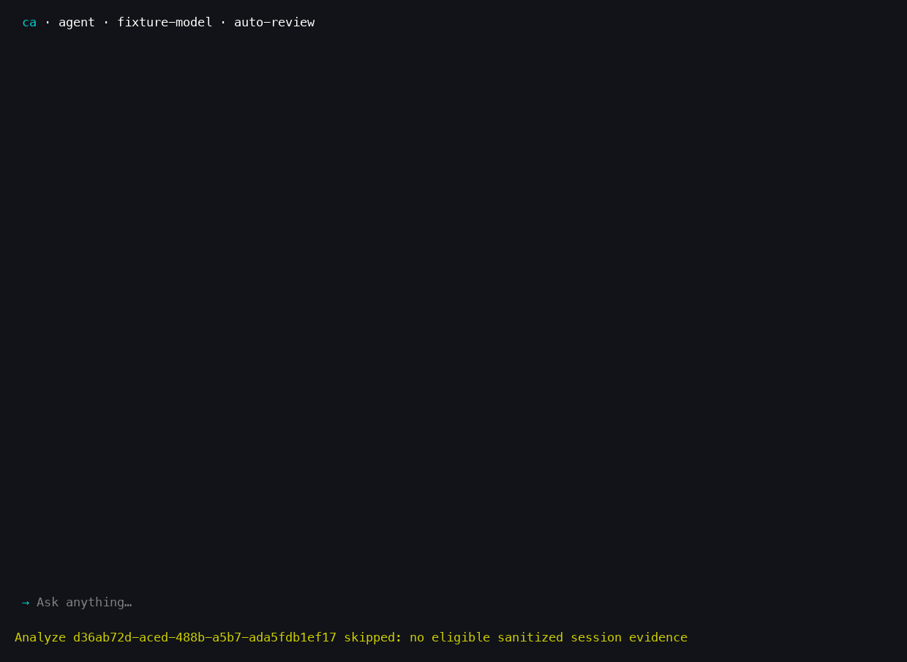

# TUI screenshots

These are captures of the actual signed `ca 0.1.0` release executable running
in a pseudo-terminal. PNGs are rendered from its emitted VT screen cells and
colors, rather than drawn UI mockups. The terminal size is 120 columns × 36 rows.
A disposable home/workspace and loopback fixture provider keep user sessions,
credentials, and live provider requests out of the captures. The sample reply is
fixture text; the screenshots establish TUI rendering, not live-model behavior.

## Agent dashboard


## Welcome



## Conversation


## Usage panel


## Command help


## Reproduce

Install `Pillow` and `pyte` in an isolated Python environment, build and sign the
release as described in [Getting started](GETTING_STARTED.md), then run:

```sh
python3 tools/tui_screenshots.py --binary target/release/ca --output docs/images
```

The default font is macOS Menlo. On another platform, pass `--font` with a local
monospace TrueType font. The tool requires loopback sockets and PTY/subprocess
access. It emits PNGs, plain-text terminal snapshots, and
[capture-receipt.json](images/capture-receipt.json) containing the executable and
image hashes. Those hashes bind this capture set; a new build or font may produce
different bytes.
