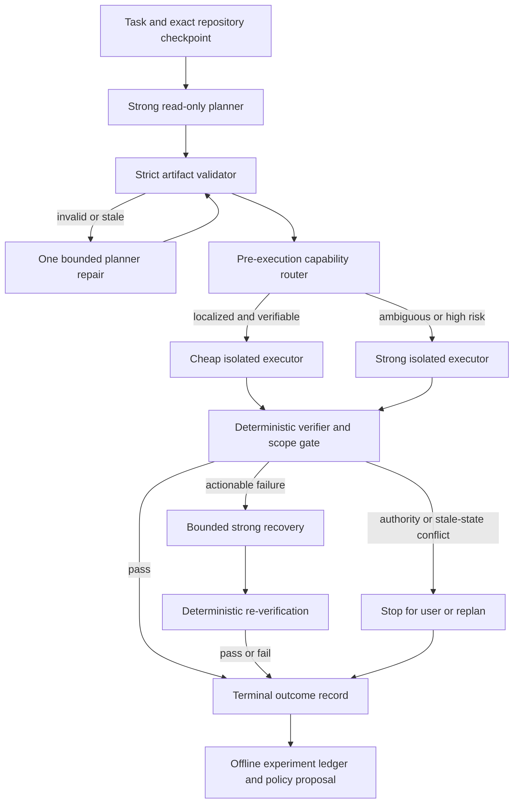

# Strong Planner, Cheap Executor

Status: research conclusion and isolated experiment design, 2026-08-12

## Executive Decision

The architecture is technically possible today, but the economic claim is not yet proven for `ca`.

The defensible version is:

1. a strong model inspects the task and repository read-only;
2. it returns a bounded, visible, provider-neutral work artifact containing conclusions, evidence, dependencies, steps, verification, and escalation conditions;
3. the harness validates and anchors that artifact to the repository state;
4. the harness routes each step to a cheap or strong executor before generation;
5. an isolated executor changes the repository under the artifact's authority;
6. deterministic checks accept, reject, or trigger one bounded strong-model recovery;
7. the harness measures total dollars per externally verified success.

The unsupported version is “run a strong model once, then give its hidden or encrypted reasoning state to an arbitrary cheaper model.” Providers use incompatible continuation mechanisms, most document only same-route or same-family reuse, Anthropic explicitly requires removing thinking blocks when changing Claude models, and only Google's Interactions API currently makes a documented within-Google model-switch promise. Cross-provider opaque replay is not a product contract.

The expected result is therefore conditional: this can reduce cost when the planner removes localization and design uncertainty, the cheap executor can follow a precise artifact, tests are strong, and escalation stays low. It can cost more when the task was predictably hard, the artifact omits a key fact, verification is weak, or the system pays for cheap execution before escalating anyway.

`ca` should proceed as an experiment, not enable automatic production routing yet.

## What “Reasoning Transfer” Can Mean

These mechanisms must remain separate:

| Mechanism | Portable across providers/models? | Suitable for this design? |
|---|---:|---|
| Ordinary user/assistant/tool history | Usually syntactically portable after adapter translation, but semantics differ | Yes, with normalization and bounds |
| Visible reasoning summary | Plain text is portable; quality and faithfulness are provider-dependent | Sometimes, as supporting evidence—not authority |
| Structured work artifact | Yes, because the harness owns and validates its schema | Yes; this is the primary handoff |
| Provider-signed/encrypted reasoning item | Generally no; it is provider-owned continuation state | Same documented route only |
| Server-side response/conversation handle | No; it names provider-side state and may still rebill prior input | Same documented provider route only |
| Prompt/context cache | No; it reuses an exact or near-exact provider prefix | Useful for cost, not reasoning transfer |
| Hidden chain of thought | Not exposed as a supported portable API object | Explicitly out of scope |

The artifact deliberately records work product, not private cognition. It says what was established, where the evidence is, what to change, what must remain true, and how to prove success. It does not attempt to reproduce the planner's hidden token-by-token deliberation.

## Provider Reality

### Support matrix

| Provider/surface | Provider continuation state | Documented replay boundary | Cross-model conclusion | Handoff policy |
|---|---|---|---|---|
| OpenAI Responses | Completed output items, opaque/encrypted reasoning content, `previous_response_id`, or Conversation state | Compatible prior Responses items on the documented Responses path | Current docs do not publish a general cross-tier compatibility matrix or arbitrary model-switch guarantee | Keep provider state route-bound; use structured IR between planner/executor models |
| Anthropic Messages | Thinking/redacted-thinking blocks plus signatures | Complete unmodified blocks within the applicable Claude conversation/tool turn | Explicitly remove thinking blocks when switching Claude models | Never transfer signed blocks to a different model |
| Gemini Interactions | Thought blocks/signatures or stateful previous-interaction handle | Stateless callers resend thought blocks; stateful callers reference the interaction | Official docs say callers should still resend the prior model's thought blocks on a compatible model switch; the backend manages compatibility | Treat as a Google-specific capability, not a general abstraction |
| Gemini `generateContent` | Thought signatures attached to model parts/function calls | Required for affected Gemini tool continuations | No equally broad cross-model promise established for this legacy surface | Same documented surface unless separately proven |
| DeepSeek Chat | Visible `reasoning_content` | Exact assistant reasoning replay is required for affected tool turns | Cross-model reuse is undocumented | `ca` may replay on its exact canonical route; portable IR remains separate |
| DeepSeek Responses | Plaintext reasoning output items in a stateless Responses-compatible surface | Caller resends the required input items; `previous_response_id`, Conversation, `store`, `include`, and `context_management` are unsupported | Cross-model reuse is undocumented; summaries and encrypted reasoning content are unsupported | Treat it as DeepSeek-owned visible history, not OpenAI Responses continuation state |
| Xiaomi MiMo Chat | Visible `reasoning_content` | Exact assistant reasoning replay is required for affected tool turns | Pro/regular or other cross-model reuse is undocumented | Same as DeepSeek |
| Xiaomi MiMo Responses | Plaintext reasoning content in caller-managed input | `previous_response_id` and `context_management` are unsupported; `none` disables reasoning while `low`/`medium`/`high` currently all mean enabled | Cross-model reuse is undocumented | Retain exact visible content on the same route; do not infer OpenAI state semantics from the wire shape |
| xAI Responses | Previous-response state or encrypted reasoning replay | Same documented Responses continuation | Cross-model reuse is undocumented | Same-route state only |
| Mistral Conversations | Visible reasoning/thinking chunks | Full assistant replay for continuation | Cross-model reuse is undocumented | Normalize visible conclusions into IR; do not promise state portability |
| Z.AI/GLM | Visible `reasoning_content` plus thinking controls | Ordered replay under its thinking contract | Cross-model reuse is undocumented | Same-route state only |

Primary documentation:

- OpenAI [reasoning guide](https://developers.openai.com/api/docs/guides/reasoning), [latest-model guidance](https://developers.openai.com/api/docs/guides/latest-model), [conversation state](https://developers.openai.com/api/docs/guides/conversation-state), and [prompt caching](https://developers.openai.com/api/docs/guides/prompt-caching)
- Anthropic [extended thinking](https://platform.claude.com/docs/en/about-claude/models/extended-thinking-models) and [pricing](https://platform.claude.com/docs/en/about-claude/pricing)
- Google [Interactions overview](https://ai.google.dev/gemini-api/docs/interactions-overview), [Interactions thinking](https://ai.google.dev/gemini-api/docs/thinking), [legacy `generateContent` thought signatures](https://ai.google.dev/gemini-api/docs/generate-content/thought-signatures), and [context caching](https://ai.google.dev/gemini-api/docs/caching)
- DeepSeek [thinking mode](https://api-docs.deepseek.com/guides/thinking_mode), [Responses compatibility](https://api-docs.deepseek.com/guides/responses_api), [context caching](https://api-docs.deepseek.com/guides/kv_cache), and [pricing](https://api-docs.deepseek.com/quick_start/pricing/)
- Xiaomi MiMo [reasoning replay](https://mimo.mi.com/docs/usage-guide/passing-back-reasoning_content), [Responses surface](https://mimo.mi.com/docs/en-US/api/chat/responses), and [pricing](https://mimo.mi.com/docs/en-US/price/pay-as-you-go)
- xAI [reasoning](https://docs.x.ai/developers/model-capabilities/text/reasoning), [advanced tool use](https://docs.x.ai/developers/tools/advanced-usage), and [prompt-cache pricing](https://docs.x.ai/developers/advanced-api-usage/prompt-caching/usage-and-pricing)
- Mistral [reasoning conversations](https://docs.mistral.ai/studio-api/conversations/reasoning) and [prompt caching](https://docs.mistral.ai/studio-api/conversations/advanced/prompt-caching)
- Z.AI [thinking mode](https://docs.z.ai/guides/capabilities/thinking-mode)

### Lifetime, restart, storage, and cost semantics

| Mechanism | Lifetime and restart behavior | Repository checkpoint use | Does it avoid paying for reasoning again? |
|---|---|---|---|
| OpenAI stored Response ID | Response objects are retained for 30 days by default; a Conversation's items are not subject to that 30-day TTL. A process can resume if it durably retains the ID and the object still exists. | Store the ID only as provider-owned state tied to route and repository checkpoint; it is not portable IR. | Not automatically. OpenAI states that every earlier input token in a `previous_response_id` chain is still billed as input. Compatible reasoning may improve continuity and caching may discount input. |
| OpenAI stateless encrypted items | The caller owns the complete output sequence. It can survive a restart if safely persisted, but the docs do not promise indefinite compatibility of an old opaque item across model/protocol changes. | Safe only in a direct fidelity checkpoint with strict provider/protocol/endpoint binding and bounded encrypted storage. | It can avoid reconstructing the model's prior hidden state, but replayed content is still input. Savings must come from fewer new reasoning/output tokens or cache discounts and must be measured. |
| Anthropic thinking/signature blocks | The Messages caller owns the blocks and can persist them across a restart. They must be replayed complete and unmodified for affected tool continuations. | Store only with the exact assistant/tool history. Strip them on a model switch. | Current-turn reasoning was already billed as output; retained prior blocks can count as input. Cache hits may discount repeated prefixes, but replay is primarily a correctness requirement. |
| Gemini stored Interaction | Paid-tier Interactions are retained for 55 days and free-tier Interactions for one day by default; paid projects can configure 7/14/28/55-day retention. Resume uses `previous_interaction_id`. | Retain the interaction ID with provider/model/API-surface and repository checkpoint metadata. | Google's docs say server-side state improves implicit-cache hit rates. That can reduce cost, but it does not make the earlier work free. |
| Gemini stateless thought blocks | Caller-owned thought blocks/signatures survive process restart if persisted byte-faithfully. | Bound to the Gemini interaction history and checkpoint; do not turn them into generic IR. | Same distinction: continuity can improve cache use and avoid semantic recomputation, while billable usage remains provider-defined. |
| DeepSeek/MiMo visible reasoning | The caller owns ordinary response text and can persist it indefinitely, subject to API/model compatibility. Exact replay is required for affected tool loops. | It can be checkpointed with exact history, but cross-model semantics remain undocumented. | Replay is required to continue correctly; neither provider documents it as a guarantee of lower total reasoning spend. |

The operational answer is therefore “yes, state can survive a harness restart when either the provider retains an addressable object or the client securely persists the complete required blocks.” That does not imply portable model state or lower billing. A benchmark must compare the next call's new reasoning/output, cache-read/write accounting, and success rate.

`ca` already preserves bounded OpenAI, DeepSeek, and MiMo continuation state in direct Session V4 records and binds it to provider, protocol, and normalized-endpoint digest. The current source identity deliberately does not include model ID; that is not evidence of cross-model compatibility. Portable exports, checkpoint prompts, request views, Debug, and UI omit the payload. The planner/executor experiment must create a fresh executor request with no copied provider response items, using visible history plus `reasoning_artifact.v1` instead.

### OpenAI-specific findings

OpenAI is useful for this design in two distinct ways, which should not be conflated.

First, Responses can preserve provider-owned reasoning across a continuation. In locally managed history, the client retains complete compatible output items; with stateless/ZDR operation, encrypted reasoning content is returned for replay. A server-side response or Conversation handle offers another continuation path. None of these is a provider-neutral planning representation.

OpenAI may also return a visible reasoning summary when requested. That summary is ordinary lossy output intended for inspection; it is distinct from the opaque or encrypted reasoning item used for continuation and must not be treated as an equivalent state transfer.

Second, the planner can emit a visible strict JSON artifact. That artifact can be validated and passed as normal input to a cheaper OpenAI tier or another provider. This is the portable path.

There are two cost subtleties:

- `previous_response_id` is not free memory; prior input in the chain continues to count as input for billing.
- prompt caching lowers the price of cache-hit tokens but does not move reasoning between models. Cache writes and reads must be counted separately where the provider exposes them.

As of the dated research snapshot, the official OpenAI model comparison lists GPT-5.6 Sol at $5 input / $0.50 cached input / $30 output per million tokens, Terra at $2 / $0.20 / $12, and Luna at $0.20 / $0.02 / $1.20. The experiment must freeze the price-card date and accept explicit rates rather than hard-code a supposedly permanent table. See [OpenAI model comparison](https://developers.openai.com/api/docs/models/compare).

### Reasoning-effort tiers are not model portability

Reasoning effort is normally a request configuration. A same-model continuation may select the effort supported for the next call while retaining whatever prior compatible state that API makes available. That is not evidence that a reasoning item produced by an expensive model is accepted or understood by a cheaper sibling model.

- OpenAI documents compatible prior reasoning items and per-request reasoning configuration, but does not publish a general Sol-to-Terra/Luna opaque-state compatibility contract.
- Anthropic allows thinking configuration changes between completed turns, not inside one tool-use turn; switching models requires stripping prior thinking blocks.
- Gemini Interactions requires generation configuration to be respecified per interaction and uniquely documents within-Gemini mixed-model conversation support subject to modality compatibility.
- DeepSeek currently maps `low` to `low`, `medium`/`high`/`xhigh` to `high`, and `max` to `max`, so several nominal effort arms are not independent treatments.

The benchmark should record exact model ID and effective effort from each response where exposed. It should never infer a cheaper tier merely from a lower effort label.

### Compatibility boundaries to test, not assume

| Provider | Same model and documented surface | Cheaper sibling/model switch | Effort change |
|---|---|---|---|
| OpenAI Responses | Supported through compatible completed items, `previous_response_id`, or Conversation state | No general Sol/Terra/Luna opaque-state compatibility contract is published | A later request can choose a supported effort, but this does not prove state portability to another model |
| Anthropic Messages | Replay complete signed thinking blocks for the applicable same-model tool turn | Explicitly strip thinking and redacted-thinking blocks when switching Claude models | May change only between completed turns, not inside one tool-use turn |
| Gemini Interactions | Stateful or exact stateless thought continuation is documented | Documented for compatible model switches when the consumer supports prior output modalities; callers should retain the prior thought blocks | Generation configuration is respecified per interaction |
| DeepSeek Chat/Responses | Exact visible reasoning replay is documented where required | Undocumented | Requested labels collapse to the provider's effective low/high/max mapping |
| Xiaomi MiMo Chat/Responses | Exact visible reasoning replay is documented where required | Undocumented | On Responses, `none` disables; `low`, `medium`, and `high` currently select the same enabled behavior |
| xAI and other compatible surfaces | Use only the provider's documented same-route continuation | Undocumented unless a provider publishes a specific compatibility rule | Treat as request configuration, not proof of cross-model transfer |

Only the Gemini row justifies an experimental cross-model opaque-state arm. Even there, record exact producer and consumer model versions, output modalities, API surface, and state mode; do not turn the exception into a generic provider abstraction.

### Why the named security research is not an implementation path

The site named in the request corresponds to the paper [Stealing Reasoning Traces from Proprietary LLM APIs](https://arxiv.org/abs/2608.09867) and its [research repository](https://github.com/mitkox/stolen-thoughts). Its reported cross-model behavior is framed as an extraction vulnerability, not a stable provider contract.

This project will not extract, decode, decrypt, inspect, publish, or rely on undocumented interchangeability of opaque reasoning artifacts. The safe lessons are narrower:

- treat opaque blocks as sensitive provider state;
- bind them to their documented runtime identity;
- exclude them from logs, portable exports, provider-neutral artifacts, and cross-model checkpoints; sealed direct-session fidelity storage is the narrow exception;
- assume undocumented acceptance can disappear or change semantics;
- transfer visible, validated conclusions instead.

## What Research Supports—and Does Not

The strongest direct coding evidence found is [An Empirical Study on Strong-Weak Model Collaboration for Repo-level Code Generation](https://arxiv.org/abs/2505.20182). On its Agentless-Lite/SWE-bench Lite setup, its most effective strong/weak strategy matched strong-model performance at roughly 60% of the cost. That is encouraging evidence, not a forecast for `ca`: model generations, prices, repository mix, and harness behavior differ.

[PEAR](https://aclanthology.org/2026.findings-eacl.237/) is especially relevant to role allocation. It found that planner quality affected utility more strongly than executor quality and that planner memory mattered more than executor memory. This supports spending capability on repository understanding and producing a compact execution contract.

Other evidence supports individual pieces:

- [Plan-and-Act](https://proceedings.mlr.press/v267/erdogan25a.html) demonstrates a structured planner/executor separation on long-horizon web tasks.
- [ADaPT](https://aclanthology.org/2024.findings-naacl.264/) shows decomposition should adapt to task complexity and executor ability.
- [QDMR dependency-graph planning](https://aclanthology.org/2024.lrec-main.1173/) supports encoding step dependencies rather than relying on prose order.
- [Agentless](https://arxiv.org/abs/2407.01489) shows that explicit localization, repair, and validation can form a competitive low-cost coding pipeline.
- [EcoAssistant](https://openreview.net/forum?id=JCpHCecgqf), [FrugalGPT](https://arxiv.org/abs/2305.05176), and [RouteLLM](https://arxiv.org/abs/2406.18665) show that cascades or routing can improve cost/quality frontiers in their evaluated domains.
- [AI Agents That Matter](https://openreview.net/forum?id=Zy4uFzMviZ) argues for joint cost/accuracy measurement, repeated runs, and reproducible environments.
- [Reasoning that Travels](https://arxiv.org/abs/2605.28913) finds that visible reasoning traces can help receiver models, but gains depend on receiver competence and may reflect answer extraction rather than transferable reasoning skill.

There is an important counterweight. [Is Escalation Worth It?](https://arxiv.org/abs/2605.06350) finds that pre-generation routing often beats cheap-first cascades because an escalated case pays for both the cheap attempt and the strong recovery. For `ca`, the planner artifact should therefore classify task/step difficulty before execution. Post-execution escalation should be reserved for high-information external signals such as compiler errors, test failures, stale evidence, or authority conflicts.

The research does not prove that:

- one universal artifact works for every coding task;
- a weak executor can perform an underspecified or ambiguous change;
- planner and recovery errors are independent;
- public benchmark pass rates predict cost on this repository;
- opaque state can be reused across providers;
- cache savings automatically survive a model or provider switch.

## Proposed `ca` Architecture



### Ownership map

| Responsibility | Existing `ca` seam | Required change after the experiment |
|---|---|---|
| Typed request identity | `src/request.rs` | Add explicit planner/executor/verifier/recovery purposes only when runtime integration begins |
| Read-only structured planner | `src/review.rs` pattern | Add a sole-report-tool planner runner; no mutation tools |
| Child execution and route selection | `src/agent/subagent.rs` | Add explicit run purpose and per-request reasoning options; do not overload “multi-run candidate” |
| Isolated repository state | `src/worktree.rs`, `src/multi_run.rs` | Start from exact clean fixture commits/worktrees |
| Artifact schema/validation | isolated experiment binary initially | Later move to a dedicated runtime module only after evidence supports it |
| Deterministic verification | `src/headless_contract.rs`, local test commands | Record machine-verifiable gates separately from model judgment |
| Usage and exact configured pricing | `src/usage.rs` | Add experiment/case/arm/phase/retry/escalation correlation in a separate ledger |
| Transcript checkpoints | `src/context.rs` | Do not repurpose; transcript summaries lack repository anchors |
| Durable sessions | `src/session.rs` | Do not add artifact state during the first experiment |
| Long-term memory | `src/memory.rs` | Do not store active artifacts or routing policy; use opt-in reviewed aggregate proposals later |
| Opaque provider continuation | `src/agent/stream.rs`, `src/agent/provider.rs` | Keep entirely outside the provider-neutral artifact |

`AgentSpawnRequest.context_summary` is a natural later handoff seam, but the executor request must be freshly constructed with no copied provider response items. `multi_run` already demonstrates exact routes and isolated worktrees, but it is a best-of-N comparison system, not yet a planner/executor router. Every pass, failure, refusal, stale-artifact stop, and exhausted recovery must still reach the experiment ledger so failed spend remains in dollars-per-success.

## `reasoning_artifact.v1`

### Design principles

The artifact is immutable, deterministic, bounded, and divided into two trust domains in a future integrated harness:

- the planner supplies visible evidence, claims, uncertainties, and plan steps, including requested affected paths;
- the harness injects schema and task identity, authenticated planner route, repository anchors, the effective `executor_contract`, verifier gates, approvals, and the artifact digest.

The planner cannot grant itself tools, widen writable paths, claim a different repository base, or spoof its provider/model identity. Requested step paths must be a subset of the harness-owned execution policy, and every cited or targeted repository path must be covered by an authenticated dependency digest (with an explicit absent-file marker for planned new files). Commands are inert strings until the normal harness approves and executes them.

The offline prototype accepts a complete artifact file from its caller and therefore cannot authenticate who supplied its provenance or policy fields. It proves strict parsing, internal authority intersection, selected path-digest verification, and accounting—not provenance attestation. A live integration must construct those fields itself.

### Logical schema

```json
{
  "schema_version": "reasoning_artifact.v1",
  "artifact_id": "case-0042-plan-1",
  "created_at": "2026-08-12T14:00:00Z",
  "planner": {
    "provider": "openai",
    "model": "gpt-5.6-sol",
    "reasoning_effort": "high"
  },
  "task": {
    "objective": "Implement the requested behavior without changing default CLI semantics.",
    "constraints": [{"id": "C1", "text": "No provider traffic"}],
    "success_criteria": [{"id": "A1", "text": "Focused regression passes"}],
    "non_goals": [{"id": "N1", "text": "No user configuration writes"}]
  },
  "repo_checkpoint": {
    "repository_id": "ca",
    "base_revision": "<exact-object-id>",
    "task_input_sha256": "<64-lowercase-hex>",
    "worktree_sha256": "<64-lowercase-hex>",
    "path_digests": [
      {"path": "src/request.rs", "sha256": "<64-lowercase-hex>"},
      {"path": "src/bin/reasoning_artifact_experiment.rs", "sha256": "<64-lowercase-hex>"}
    ]
  },
  "evidence": [{
    "id": "E1",
    "kind": "source_observation",
    "observation": "PreparedModelRequest is the typed request boundary.",
    "checkpoint_paths": ["src/request.rs"],
    "source": "local repository inspection"
  }],
  "claims": [{
    "id": "F1",
    "statement": "Normal runtime behavior can remain unchanged.",
    "confidence": "high",
    "evidence_ids": ["E1"]
  }],
  "uncertainties": [{
    "id": "U1",
    "statement": "Live provider quality is unmeasured.",
    "impact": "No production routing decision is justified.",
    "resolution": "Run an authorized controlled benchmark.",
    "evidence_ids": ["E1"]
  }],
  "plan": {
    "steps": [
      {
        "id": "S1",
        "title": "Add the isolated validator",
        "depends_on": [],
        "instructions": "Add the isolated strict schema and validator.",
        "evidence_ids": ["E1"],
        "affected_paths": ["src/bin/reasoning_artifact_experiment.rs"],
        "created_paths": [],
        "validation": {
          "commands": ["cargo test --features planner-executor-experiment --bin ca-reasoning-artifact-experiment"],
          "expected_outcomes": ["All focused tests pass"]
        }
      }
    ]
  },
  "executor_contract": {
    "allowed_tools": ["read_repository", "edit_repository", "run_approved_commands"],
    "allowed_paths": ["src/bin/reasoning_artifact_experiment.rs"],
    "forbidden_actions": ["No credentials or network"],
    "budgets": {"max_turns": 20, "max_requests": 20, "max_input_tokens": 200000, "max_output_tokens": 40000, "max_tool_calls": 100, "max_wall_time_seconds": 3600, "max_cost_usd": "5.00"},
    "stop_conditions": ["Stop after all required gates pass"],
    "escalation_triggers": ["A dependency changed", "A forbidden path is required"]
  },
  "verifier": {
    "gates": [{"id": "G1", "criterion_ids": ["A1"], "step_ids": ["S1"], "command": "cargo fmt --check", "expected_outcome": "exit 0", "required": true}],
    "escalation_policy": {"max_escalations": 1, "on_required_gate_failure": "escalate", "on_stale_checkpoint": "refresh_plan", "planner_refresh_allowed": true}
  }
}
```

This is the logical contract. The experiment binary's emitted JSON Schema is the executable source of truth for its implemented subset.

### Required validation

- strict unknown-field rejection;
- maximum total JSON bytes;
- maximum counts for facts, paths, steps, dependencies, checks, and escalation reasons;
- bounded UTF-8 strings without unsafe controls;
- workspace-relative normalized paths only; no absolute paths, `..`, NUL, or empty segments;
- unique step IDs and an acyclic dependency graph;
- every dependency references an existing step;
- requested step paths are unique and remain inside the effective allowed path set;
- nonempty objective, success criteria, steps, verification, and escalation policy;
- lowercase fixed-width SHA-256 digests;
- no fields for credentials, headers, provider response items, encrypted state, raw chain of thought, or transcript dumps;
- every evidence path and existing plan target is covered by a repository dependency digest; a planned new file uses a typed absent-file anchor;
- deterministic serialization and artifact hash;
- redacted diagnostics for artifact prose where logs may leave the process.

The prototype implements the structural, bounds, DAG/reference, authority-subset, verifier-coverage, secret-pattern, and selected path-digest checks. Full anchor authentication, absent-file anchors, and proof that every target was harness-derived remain live-integration requirements rather than completed prototype claims.

### Repository checkpoint and invalidation

For a live experiment, require a clean fixture commit and fail closed if either the base object ID or working-tree digest changes before execution. The current offline prototype stores those values but verifies only explicitly declared path digests when `validate --repo` is used; it does not yet authenticate the full Git/worktree/task anchor. A later path-aware implementation may revalidate only the dependencies declared by the next step after the harness proves the complete initial anchor.

A complete production anchor should include:

- exact base commit/tree and submodule revisions;
- canonical staged, unstaged, and untracked bytes when dirty worktrees are eventually allowed;
- toolchain, lockfile, and environment/container digests;
- relevant source/symbol hashes;
- initial test fingerprints;
- allowed and forbidden paths.

The reasoning artifact remains immutable after validation. Expected writes advance a separate execution checkpoint; they never rewrite the planner artifact. An unexpected change to a dependency, an undeclared write, or a mismatched environment stops the cheap executor and requests a bounded replan. Git's [object model](https://git-scm.com/book/en/v2/Git-Internals-Git-Objects) is appropriate for clean state, while [`git status --porcelain=v2 -z`](https://git-scm.com/docs/git-status) is the machine-readable basis for eventual dirty-state manifests. `patch-id` is not an exact worktree identity because it intentionally normalizes differences.

### Weak-executor contract

| Handoff form | Weak-executor value | Main failure |
|---|---|---|
| Prose summary | Cheap and readable | Omits dependencies, cannot be validated, invites rediscovery |
| Detailed ordered plan | Better action guidance | Order alone hides causal dependencies and stale assumptions |
| Facts plus rejected hypotheses | Prevents repeated diagnosis | Needs direct evidence references or it becomes planner assertion |
| Constraints and invariants | Protects behavior outside the edit | Weak model may not know which step threatens which invariant |
| Dependency DAG | Makes readiness and parallelism explicit | More schema/token overhead; invalid graphs must fail before execution |
| File/symbol targeting | Reduces localization work | Becomes dangerous when repository state changes |
| Explicit tool sequence | Can make mechanical work reliable | Brittle when an expected observation differs; must include stop branches |
| Expected observations | Lets the executor compare reality to the plan | Requires precise, testable wording |
| Verification criteria | Enables deterministic acceptance | Visible checks can still be incomplete |
| Escalation triggers | Prevents expensive improvisation | Poorly calibrated triggers either over-escalate or hide failure |

The recommended artifact combines all rows except a rigid universal tool sequence. Steps carry dependencies, target scope, expected observations, checks, and stop/escalation conditions; the executor may choose among permitted tools but cannot widen authority or invent around a contradiction.

The cheap executor should receive:

- the task objective and explicit non-goals;
- established facts with direct repository references;
- current step and prerequisite outcomes;
- allowed reads/writes and tools;
- expected observations;
- deterministic verification and stop conditions;
- a compact current repository checkpoint.

It should not receive:

- the planner's private transcript or opaque reasoning state;
- authority wider than the current step;
- an instruction to improvise around missing facts;
- stale conclusions presented as current truth;
- an unbounded history of failed cheap attempts.

Detailed prose alone is better than a one-line summary, but it is hard to validate. A dependency DAG plus facts/invariants/rejected hypotheses prevents repeated discovery and tells a weak executor when not to proceed. Fixed commands can become brittle, so the artifact should specify allowed tools and expected observations rather than demand a blind sequence when alternatives are safe.

## Routing and Escalation

### Pre-route directly to a strong executor when

- the planner records unresolved product or architectural decisions;
- localization is wide, unknown, or crosses protocol/session/concurrency boundaries;
- deterministic verification is absent or weak;
- migration, permissions, destructive operations, or external coordination are required;
- the artifact needs authority beyond the accepted scope;
- the measured cheap-executor success for the task stratum is below policy threshold.

### Let a cheap executor attempt when

- targets and invariants are precise;
- the edit is localized and mechanically described;
- tools and permissions are bounded;
- verification is strong and fast;
- no unresolved decision remains;
- the artifact is fresh.

### Escalate on external evidence

- schema repair failed once;
- repository dependency hash changed;
- forbidden-file or permission expansion is required;
- compiler/test diagnostics repeat without improvement;
- executor output contradicts a cited fact;
- budget, retry, tool-call, or wall-time limit is reached;
- deterministic gates cannot establish success;
- the patch passes visible checks but violates a scope/invariant gate.

Send recovery the current checkpoint, compact failure evidence, patch, and remaining artifact—not the full cheap-model transcript. Allow one bounded strong recovery in the first benchmark. Stop rather than silently expanding authority.

## Benchmark

### Conditions

The four minimum arms requested by the user are present, with matched diagnostic controls:

| Arm | Planner | Executor | Handoff | Recovery | What it isolates |
|---|---|---|---|---|---|
| `S0` | strong | strong | ordinary monolithic context | none beyond the fixed ordinary retry budget | strong-only baseline |
| `C0` | cheap | cheap | ordinary monolithic context | none beyond the same fixed ordinary retry budget | cheap-only floor |
| `SS` | strong | fresh strong | structured artifact only | none | combined decomposition/orchestration/handoff effect |
| `SC` | strong | cheap | structured artifact only | none | executor capability loss relative to `SS` |
| `SC-G` | strong | pre-routed cheap/strong | structured artifact | deterministic gate plus one strong recovery | proposed policy |
| `SP` | strong | cheap | size-matched unstructured prose plan | none | schema value relative to `SC` |
| `OR-H` (optional) | one documented route | same route/model | visible ordinary history | none | matched same-route control |
| `OR-S` (optional) | one documented route | same route/model | provider-owned continuation state | none | same-route continuation/cache effect |
| `GX-IR` (optional) | strong Gemini | fresh cheaper compatible Gemini | structured artifact, no prior thought blocks | none | Google cross-model visible-IR control |
| `GX-STATE` (optional) | strong Gemini | cheaper compatible Gemini | documented Interactions continuation state | none | Google-specific cross-model state effect |

Run `OR-S` only where the official API documents the exact replay mode and compare it with `OR-H` under the same model, tools, history content, and cache condition. For `GX-IR`/`GX-STATE`, hold producer/consumer models, task, tool schema, output modalities, and verification fixed; vary only visible IR versus Google's documented compatible state continuation. These are provider-specific characterizations, not a generic cross-provider handoff contract.

All no-recovery arms use the same declared transport-retry policy and bounded ordinary model-call budget; they never cross-route after a semantic failure. `SC-G` alone adds the explicit deterministic-gate recovery. This prevents a hidden cascade from contaminating the handoff and schema comparisons.

### Task set

Use fresh held-out tasks with deterministic external verification. Public SWE-bench tasks alone are insufficient because of contamination and benchmark defects; [SWE-bench Live](https://arxiv.org/abs/2505.23419) is a better external supplement, not a replacement for private recent fixtures.

Stratify by:

- localization width and number of files;
- mechanical edit versus product/design ambiguity;
- protocol, persistence, concurrency, and migration risk;
- expected number and dependency depth of steps;
- test/oracle strength;
- tool and permission requirements;
- expected context size.

Start with a pilot of roughly 30 tasks and three independent repetitions per condition. Do not call repetitions “seeds” unless the provider exposes a deterministic seed that is actually fixed. Use pilot variance to power a confirmatory run rather than treating 30 as sufficient. Randomize condition order within each task, freeze exact model IDs/prompts/tool schemas/environment images/price-card versions, and start every run from the same commit in a fresh isolated worktree.

The strong planner is read-only. Executors see the validated artifact and repository, not hidden reasoning or the planner transcript. Primary success comes from compilation, focused and hidden tests, formatting/lint, scope checks, and required runtime behavior. A model judge may be a secondary metric but cannot be the sole oracle.

### Metrics

Primary:

- externally verified success rate;
- total dollars per verified success;
- false acceptance rate.

Secondary:

- cost per attempt and per phase;
- escalation and false-escalation rate;
- decomposition/orchestration/handoff effect (`S0` versus `SS`);
- executor loss (`SS` versus `SC`);
- schema value (`SP` versus `SC`), with executor and recovery held fixed;
- Google-specific state value (`GX-IR` versus `GX-STATE`) when that optional pair is authorized;
- stale-artifact and forbidden-write rate;
- input, cached-input, cache-write, output, and reasoning tokens;
- calls, retries, tool calls, compute/test time, and human interventions;
- p50/p95 wall time;
- changed lines and redundant operations;
- artifact bytes and tokens, plus a size-matched prose/IR information-content audit.

Cluster confidence intervals by task because repetitions for one task are correlated. Pre-register a success non-inferiority margin—three percentage points is a reasonable starting proposal, not a universal constant. Among policies within that margin of `S0`, choose the lowest dollars per verified success. Report pass rate and cost per attempt beside the ratio so an apparently cheap but low-throughput policy is visible.

### Contamination and fairness controls

- use recent/private tasks and record task provenance;
- never expose hidden tests to planner or executor;
- keep repository, image, tools, timeouts, and verification identical across arms;
- freeze prompts and schema versions before the confirmatory run;
- separate cold-cache and warm-cache analyses;
- randomize execution order to reduce provider load/cache/update bias;
- record exact provider/model/date and all retry/error outcomes;
- retain failed-run costs in the denominator calculation;
- do not tune the router on confirmatory tasks.

## Cost Model

For call `j`, using the billable dimensions exposed by its provider:

\[
C_j = \frac{
I_{regular,j}P_{input}
+ I_{cache,j}P_{cache-read}
+ I_{write,j}P_{cache-write}
+ O_{regular,j}P_{output}
+ O_{reason,j}P_{reason}
}{10^6}
+ C_{tools,j} + C_{compute,j} + C_{human,j}
\]

The five token counters in that formula are mutually exclusive billable categories. Provider usage objects often report cached input as a subset of total input and reasoning output as a subset of total output, so normalize them first: for example, `I_regular = I_total - I_cache - I_write` and `O_regular = O_total - O_reason` only when that provider defines those subset relations. If reasoning tokens use the ordinary output rate, set `P_reason = P_output`; do not count them twice. If a provider does not expose a category or exact configured rate, keep cost unknown rather than substituting zero.

Pricing is a per-call piecewise function, not one global model constant. Select the applicable context-length tier, service tier, batch/priority mode, cache-write multiplier, and date-pinned price card before multiplying tokens. Deterministic compiler/test/sandbox expense belongs in `C_compute`; an optional model verifier is a separate metered verifier request, never silently folded into deterministic compute.

For planner + executor + initial verification + probabilistic recovery:

\[
E[C_{PE}] = C_P + C_E + C_{V0} + q(C_R + C_{V1})
\]

where `q` is the escalation probability. Let `a` be the probability that the first execution is accepted and truly correct, and `r` the probability that strong recovery succeeds conditional on escalation:

\[
P(success_{PE}) = a + qr
\]

\[
DollarsPerSuccess_{PE} = \frac{E[C_{PE}]}{a + qr}
\]

Compare it to strong-only:

\[
\frac{C_P+C_E+C_{V0}+q(C_R+C_{V1})}{a+qr}
<
\frac{C_S}{p_S}
\]

Ignoring success differences, the simple escalation-rate break-even is:

\[
q < \frac{C_S-C_P-C_E-C_{V0}}{C_R+C_{V1}}
\]

This simplified threshold is useful for intuition but not policy selection. It ignores correlated errors, quality loss, latency, and heterogeneous task difficulty.

Illustrative only, using the dated OpenAI rates above, no cache, and zero tool/compute fees: a Sol end-to-end run with 50k input and 10k output tokens costs about `$0.55`. A Sol plan with 30k input/4k output costs `$0.27`; a Luna execution with 30k/6k costs `$0.0132`; and a Luna verification with 10k/1k costs `$0.0032`, for `$0.2864` before recovery. If one full Sol recovery plus re-verification costs `$0.5532`, the cost-only break-even escalation rate is roughly 48%. This is not a quality claim: a lower first-pass success rate can eliminate the apparent saving, while cache hits or smaller artifacts can improve it.

The three requested strategies can be represented directly:

\[
C_A = C_{strong\ end\text{-}to\text{-}end} + C_{verify}
\]

\[
E[C_B] = C_{strong\ planner} + C_{cheap\ executor} + C_{cheap\ verifier}
+ q_B(C_{strong\ recovery}+C_{verify\ again})
\]

For `k` cheap workers, all generated attempts are billable even if only one wins:

\[
E[C_C] = C_{strong\ planner}
+ \sum_{i=1}^{k} C_{cheap\ worker,i}
+ C_{selection/verification}
+ q_C(C_{strong\ recovery}+C_{verify\ again})
\]

Do not estimate the success of `k` workers as `1-(1-p)^k` unless measured failures are independent. Coding-agent failures are often correlated because every worker inherits the same planner error, repository ambiguity, or weak test oracle. Several cheap workers are economically sensible only when they explore meaningfully distinct, predeclared alternatives and their combined cost plus selection is lower than routing that stratum directly to a strong executor.

For observed benchmark runs, use:

\[
\widehat{DPS} =
\frac{\sum_i C_i}{\sum_i \mathbf{1}[externally\ verified\ success_i]}
\]

This naturally includes the spend of failed attempts. Parallel cheap workers cost the sum of their calls; do not model best-of-N as independent success unless the data demonstrates independence.

### Caching strategy

Arrange repeated executor requests as:

1. stable system and tool definitions;
2. stable artifact schema and repository index;
3. stable validated plan;
4. current step, checkpoint, and dynamic tool output last.

For a stable prefix of `S` tokens reused for `m` calls, caching is cheaper than uncached repetition only when:

\[
S[P_{write} + (m-1)P_{read}] < mS P_{input}
\]

The first cheap-executor call must populate that executor model's own cache; a strong planner's cache does not transfer across a model or provider switch. OpenAI's current GPT-5.6 family requires at least 1,024 prefix tokens for caching and bills the initial cache write at `1.25×` uncached input, so one short or one-off request may not benefit even when later reads are discounted.

Measure provider-reported cache reads and writes. Analyze cold and realistic warm runs separately. Never assume a planner's cache survives a model/provider switch, and never count a server-side continuation handle as free input. Traditional [speculative decoding](https://proceedings.mlr.press/v202/leviathan23a) optimizes token-generation latency through target verification; it is not semantic planner/executor handoff and does not solve this problem.

## Failure Modes and Safety Controls

| Failure | Consequence | Control |
|---|---|---|
| Planner omits a crucial observation | cheap executor confidently follows an incomplete plan | evidence references, uncertainty fields, path freshness, strong `SS` control arm |
| Planner chooses the wrong design | cheap execution faithfully creates the wrong patch | independent deterministic verifier; escalate contradictions, not planner confidence |
| Weak executor cannot localize or edit precisely | retries erase savings | pre-route by artifact features; atomic steps; strict retry budget |
| Task changes after planning | stale instructions produce invalid edits | repository anchors and per-step dependency checks |
| Cheap-first double spend | higher cost and latency | route before generation; post-failure escalation only on informative signals |
| Planner and recovery repeat one mistaken assumption | recovery fails expensively | send contradictory external evidence; track correlated failures by task |
| Visible tests are incomplete | false acceptance | hidden/adversarial tests, scope/invariant gates, runtime behavior checks |
| Cache assumptions are wrong | projected savings do not materialize | record actual cache usage; cold/warm reports |
| Provider prices/models drift | irreproducible economics | freeze model IDs, timestamps, and explicit price cards |
| Opaque state enters the artifact/log | sensitive state crosses trust boundary | schema has no state field; strict unknown-field rejection; sealed direct-session storage stays separate |
| Credentials or private code appear in arbitrary prose | schema field exclusion alone misses sensitive strings | treat every artifact as sensitive repository data; bounded secret scanning, redacted diagnostics, least-retention storage, and no cross-provider send without policy approval |
| Repository text prompt-injects the planner | malicious comments/docs distort the plan or request authority | mark repository content as untrusted evidence; harness-owned policy, direct source citations, contradiction checks, and deterministic gates |
| Cross-provider handoff violates code/data policy | a cheaper route receives data it was not authorized to process | bind each experiment arm to an explicit provider/data-residency policy and redact or refuse before traffic |
| Artifact grants excessive authority | cheap executor expands scope | harness-owned grants, allowed-write intersection, existing approvals |
| Flaky verifier changes labels | success and escalation rates become noisy or wrong | repeat/characterize flaky gates, preserve raw results, and exclude unresolved oracle failures from policy training |
| Model alias/version drifts | the same arm silently becomes a different treatment | record exact returned model/version when exposed; pin immutable IDs where available and restart validation after drift |
| Serial stages increase tail latency | cheaper but slower product | p50/p95 time and human wait as first-class metrics |
| Online learner optimizes false successes | unsafe routing policy | offline outcome aggregation, reviewed proposals, no automatic activation |

Portable export/import is transcript-portable, not continuation-equivalent for provider-owned state. If a planner or executor resumes through a different route, it must use the structured artifact and ordinary visible history, not assume exact continuation fidelity.

## Learning From Outcomes

Do not train routing directly from self-reported model success. Keep the immutable `reasoning_artifact.v1` separate from an append-only execution record. A future integrated harness should finish each attempt with a `ca.reasoning_run.v1` envelope such as:

```json
{
  "schema_version": "ca.reasoning_run.v1",
  "session_id": "session-…",
  "experiment_id": "experiment-…",
  "case_id": "case-…",
  "arm_id": "SC",
  "repetition": 2,
  "artifact_id": "case-…-plan-1",
  "artifact_sha256": "<64-lowercase-hex>",
  "routes": [{"phase": "planner", "provider": "openai", "model": "gpt-5.6-sol", "model_version": "<returned-version>"}],
  "repository": {"before": "<anchor>", "after": "<anchor>", "execution_checkpoints": ["<digest>"]},
  "tool_calls": [{"name": "apply_patch", "outcome": "success"}],
  "test_results": [{"gate_id": "G1", "outcome": "pass", "duration_ms": 1234}],
  "outcome": "externally_verified_success",
  "usage": {"regular_input_tokens": 0, "cached_input_tokens": 0, "cache_write_tokens": 0, "regular_output_tokens": 0, "reasoning_output_tokens": 0},
  "cost_usd": "0.000000",
  "escalation": {"triggered": false, "reason": null},
  "opaque_state_ref": null
}
```

The run record may reference a separately sealed same-route fidelity object, but never embeds its opaque bytes. Execution checkpoints advance in the run record while the artifact and its original repository evidence remain unchanged. The current offline cost input implements a smaller strict per-arm usage ledger, not this full outcome envelope.

Record at least:

- experiment, case, arm, repetition, and artifact IDs;
- task strata and artifact features;
- exact planner/executor/verifier/recovery routes;
- per-phase token/cost/cache/tool/retry/time measurements;
- repository before/after anchors;
- deterministic gate results and false-acceptance findings;
- escalation trigger and recovery outcome.

An offline job may fit a calibrated success/cost estimate per task stratum and propose route thresholds. A human reviews the proposal before activation. This complements `ca` memory; it must not automatically write memory, change provider defaults, expand permissions, or mutate a running task.

## Prioritized Implementation Plan

### P0 — Land the offline contract experiment

- Keep the prototype behind `planner-executor-experiment` and outside normal `ca` CLI/TUI paths.
- Generate its JSON Schema, validate strict artifacts and DAGs, check declared path hashes, and aggregate explicit price/usage fixtures.
- Require no network, credentials, runtime writes, or provider configuration.

Exit criterion: focused feature tests plus default and all-feature completion gates pass; default help exposes nothing experimental.

### P1 — Run a no-provider fixture benchmark

- Build recent clean-Git coding fixtures with deterministic tests.
- Have humans or recorded fixtures supply artifacts to test validator, staleness, executor permissions, verifier outcomes, and ledger correlation.
- Verify that provider-owned response-state sentinels cannot enter executor artifacts or logs.

Exit criterion: the experiment harness is reproducible before any paid model comparison.

### P2 — Add explicit planner and run-purpose seams

- Add a read-only sole-report-tool planner modeled on review.
- Introduce `AgentRunPurpose::{Planner, Executor, Verifier, Recovery}` instead of labeling every routed child a multi-run candidate.
- Support per-request reasoning effort and a fresh executor context with no copied provider response items.
- Add run/case/arm/phase correlation to a separate experimental ledger.

Exit criterion: loopback tests prove exact route ownership, no opaque-state crossing, stale-before-traffic refusal, and bounded escalation.

### P3 — Paid pilot

- Run the six core arms on roughly 30 fresh tasks × three independent repetitions with frozen price cards; run the optional matched provider-state pairs only where authorized and documented.
- Analyze success non-inferiority, dollars per verified success, false acceptance, and escalation by task stratum.
- Keep automatic routing disabled.

Exit criterion: a preregistered report shows whether and where `SC-G` dominates `S0`; uncertainty is explicit.

### P4 — Narrow opt-in runtime trial

- Enable only task strata where the pilot shows a robust economic win.
- Start with localized, well-tested changes and one bounded recovery.
- Show the route/cost policy to the user; retain existing authority and approval boundaries.

Exit criterion: held-out results reproduce the win without worse false acceptance or unacceptable latency.

### P5 — Reviewed offline policy learning

- Learn calibrated route proposals from verified outcomes.
- Version and review every policy; never auto-activate or silently widen it.
- Re-evaluate after provider/model/price changes.

## Prototype Boundary

The repository contains an isolated compile-time-gated experiment binary. It is intended to prove the artifact/schema/cost boundary, not model quality or production orchestration.

It may:

- emit the implemented JSON Schema;
- validate explicit JSON input and repository dependency hashes;
- compute deterministic artifact identity;
- aggregate explicit run-cost records and dollars per verified success from caller-declared, date-stamped price-card IDs and billing tiers.

It may not:

- call a provider or read API keys;
- mutate the repository, config, session, Keychain, memory, or provider defaults;
- invoke normal `ca` tools or executors;
- expose itself through the default `ca` command;
- claim the central cost hypothesis is proven.

The prototype's totals are exact arithmetic over declared disjoint counters and rates; they are not provider invoices. Unknown rates must be resolved before aggregation rather than encoded as zero, and a future live ledger should reconcile declared totals with provider billing exports where available.

## Final Assessment

The design is worth testing. It aligns with the best available planner/executor evidence, uses primitives `ca` already has, and avoids relying on unsupported hidden-state transfer. The strongest likely win is not “all cheap execution”; it is strong planning plus pre-routing: cheap execution for narrow, well-specified, strongly verified steps, and strong execution for ambiguity or high-risk work.

The decision to ship automatic routing must wait for a reproducible task-clustered benchmark. The success criterion is lower total dollars per externally verified success at non-inferior quality—not fewer raw tokens, a cheaper first call, or a provider accepting an opaque blob.
