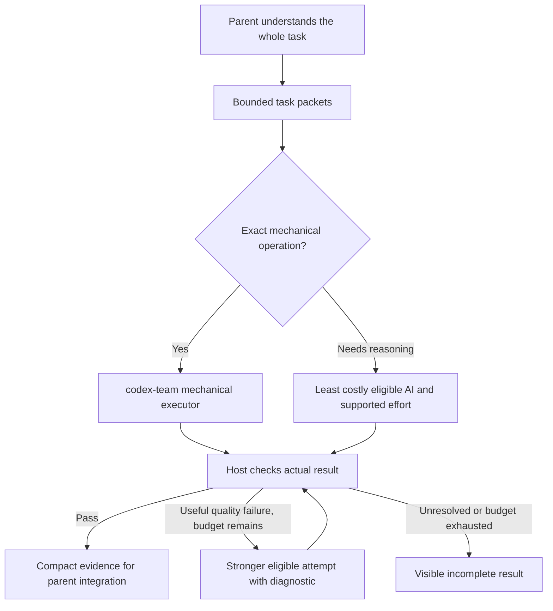

Do not start this plan. M0 through M5 are finished. The continuation is [verify-drive](verify-drive.md). A live cheaper-quality claim stays separately authorized.

# AGT-271 — Task-first economic delegation

Status: M0 through M5 checked. A live cheaper-quality claim stays separately authorized.
Date: 2026-10-10

M5 is checked. The credentialless fixture `economic_delegation_acceptance_fixture` passes. A live cheaper-quality claim stays separately authorized.

## Allowed files

M0 may add the test below in `src/mechanistic_delegation.rs` only.

Later milestones may edit:

- `src/mechanistic_delegation.rs`
- `src/agent_graph.rs`
- `src/agent/subagent.rs`
- `src/pricing.rs`
- `src/work.rs`
- `src/main.rs`, only `perform_agent_graph_tick` and the call that starts a ready graph node

`crates/codex-team/` stays untouched until M3, and then only a recipe catalog the plan names. `oracles/`, `reference/`, and `ca-hrs-252/` stay untouched.

## First failing test

Name: `mechanical_task_packet_admits_without_a_provider_request`

File: `src/mechanistic_delegation.rs`, in the existing test module.

What it asserts:

- Admit one packet whose operation is `MechanisticActionV1::ListTrackedFiles` with a bounded `max_entries`.
- The admission is mechanical. The executor is the existing codex-team engine. The provider-request count is 0.
- The admission does not create an AI graph child.

Why it fails now: `admit_task_packet` is not defined. `ready_tasks` in `src/agent_graph.rs` still returns nodes that the tick starts as AI children. `learned_route_ranking_selects_a_qualifying_allowed_route` in `src/agent/subagent.rs` already covers allowlist-before-cheaper-route for learned delegation. Leave that test alone. It is not M0.

Run: `python3 scripts/check-change.py --selector mechanical_task_packet_admits_without_a_provider_request`

The first run failed because the function is missing. Do not make the test pass by weakening the assertion.

Recorded run: `python3 scripts/check-change.py --selector mechanical_task_packet_admits_without_a_provider_request` on 2026-11-13. Receipt `scratch/check-change/runs/20261113T205846Z-8083/report.json`. The compile failed with `cannot find function admit_task_packet` at `src/mechanistic_delegation.rs:6080`. Fmt and Clippy did not run. No release was installed.

## Progress

- [x] M0. Add the failing test above. No production change. The focused compile failed on the missing function, receipt `scratch/check-change/runs/20261113T205846Z-8083/report.json`.
- [x] M1. Typed task packet and admission policy. Failure-first coverage for allowed-route filtering, model and tool compatibility, effort validation, assembled-context bounds, and explicit-route precedence. `admit_typed_task_packet` in `src/mechanistic_delegation.rs`.
- [x] M2. Freeze selected guidance, context, and route options at admission. Local definitions go through the existing manager. Human authority stays. Snapshot fields are on `TypedPacketAdmission`.
- [x] M3. One economic admission path for ordinary, proactive, and graph work. A mechanical part dispatches through the existing codex-team engine and makes zero provider requests. CA does not add a second mechanical executor. Hook: `AgentManager::spawn_with_inherited_policy`.
- [x] M4. One stronger attempt reuses the same grants and remaining budget. Failed checks stay. Existing completion barriers stay. Receipt `scratch/check-change/runs/20261114T014046Z-38654/report.json`. Installed ca 0.1.130.
- [x] M5. The decisive fixture `economic_delegation_acceptance_fixture` passes, including the credentialless control-flow cases. Receipt `scratch/check-change/runs/20261114T030846Z-31802/report.json`. Installed ca 0.1.132. A live cheaper-quality claim stays separately authorized.

## User intent

Task success takes priority. Decompose work where doing so turns uncertain work
into bounded, mechanically checkable operations. Use deterministic tools when
they can complete a part; use a cheaper AI when the remaining part is suitable.
The user explicitly selected automatic choice followed by verification and
escalation. Focused environments and applicable, reusable, editable Markdown
guidance should make those bounded tasks easier to repeat reliably.
The user also confirmed that codex-team owns mechanical, non-AI task execution.
CA owns decomposition, admission, coordination and integration; it dispatches
mechanical work to codex-team and consumes its evidence through the existing
permission, budget and verification boundaries.
Extend codex-team's typed operation/recipe catalog where needed, while keeping
untracked and non-Git work visible; selecting a repository-only operation cannot
silently narrow the task's scope.

This is the architecture assessment requested alongside AGT-270. The policy
below is proposed, not installed behavior. AGT-270 supplies explicit cross-provider
selection/control and correct allowed-route filtering. Its complete gate and
recoverable signed installation pass; it does not establish economic task
decomposition.

## Current capabilities and observed gaps

| Boundary | Current source behavior | Required connection |
| --- | --- | --- |
| Mechanical work | Repository queries and verification use the shared codex-team engine without a child AI request (`mechanistic_delegation.rs`). | Let a typed task packet dispatch an exact supported mechanical operation to codex-team. |
| Decomposition | `agent_graph.rs` has dependencies, writer lanes, scoped grants, worktree assignments, finite budgets and host evidence. | Ordinary work needs a bounded decomposition policy; every current ready graph node still starts an AI child. |
| Route selection | `pricing.rs` filters fresh supported pricing and capability, then ranks a task/summary estimate with a fixed output forecast. | Filter permitted routes and tool/profile compatibility before ranking; forecast actual assembled context, effort, verification and escalation. |
| Automatic entry points | Model-requested complexity can use pricing. Learned mode requests Standard but currently has no outcome/health scoring; proactive and graph admission use their inherited/default route directly. | Share one admission policy across ordinary, proactive and graph work. |
| Route allowlist | The audit reproduced post-ranking rejection despite an eligible allowed route; the installed AGT-270 release filters allowed candidates before ranking. | Keep this verified invariant in the shared policy. |
| Reasoning effort | Child requests use `ChatRequestOptions::default()`; child route metadata carries images/cache but does not freeze model-profile effort/tool-call settings. | Freeze and validate supported route-specific request options before dispatch. |
| Context | Children have fresh conversations and scoped grants, but ordinary prompts can contain the full plan, active session skills and a task-skill snapshot read at run time. | Freeze only relevant task inputs and selected guidance at admission; account for the complete input budget. |
| Local Markdown | Portable skills and personality files work; `.ca/agents/*.md` definitions are not connected to normal managed `task` execution. | Integrate local definitions through the existing manager and permission boundary. |
| Verification/escalation | Graphs have host artifact/closed-command checks; retries are explicit, and ordinary children have no shared economic escalation contract. | Verify bounded cheap attempts, then authorize one useful stronger attempt within the same grants and remaining budget. |

These findings come from current source inspection, not provider-name heuristics,
configuration flags or paid inference. Independent audits are retained under
`scratch/cross-provider-subagents/economic-routing-audit.md` and the current
task's agent messages. Existing code references include:

- `src/agent/subagent.rs`: route selection, child prompt preparation and manager admission.
- `src/agent_graph.rs`: graph definitions, evidence contracts and host verification.
- `src/main.rs`: graph task dispatch and delegation configuration.
- `src/proactive_delegation.rs`: ordinary host-owned Explorer admission.
- `src/mechanistic_delegation.rs`: native mechanical query/verification execution.
- `src/agent/tools.rs` and `src/workspace.rs`: local-definition legacy path and managed task-name validation.
- `src/skills.rs`: bounded, digest-pinned editable guidance loading.

## Proposed execution contract

One bounded task packet should carry the objective, relevant inputs/paths,
dependencies, required capabilities, allowed operations, success verifier,
context/output budget, selected guidance identities and digests, route policy,
supported effort, and a finite attempt limit. The host validates this packet
before execution. The task's success check stays unchanged across attempts.

Decompose around independently checkable outputs and stable interfaces, not
arbitrary token chunks. Keep coupled design, ambiguous requirements and final
integration with a capable parent. For example, locating call sites, running a
fixed test, or checking an artifact can be mechanical; classifying bounded cases
may suit a cheaper agent; choosing the behavioral change may need stronger
reasoning. A task with no trustworthy cheap success check should retain a
capable route rather than accumulate weak attempts.

Rank expected total work: decomposition and orchestration, complete input and
output, verification, and a bounded possible escalation. Splitting further is
useful only when the expected gain exceeds this overhead. Unpriced subscription
routes remain explicitly unpriced; monetary savings cannot be claimed from
missing usage or a lower advertised token rate.

Preserve explicit AGT-270 route pins, existing same/fixed defaults, human/project
instructions and frozen grants. Keep manually approved graph start/retry and
receipt rules intact when economic policy is not enabled. Add a named economic policy for automatic
selection once enabled. Apply permission, route allowlist, protocol/tool support
and effort compatibility before scoring. The code must not infer intelligence
or supported effort from a model's name.
Check the assembled request against the exact configured model's context and
output limits before admission. Keep reusable procedures stable; outcome
evidence may inform task-specific suitability without becoming human authority.

## Focused contexts and reusable Markdown

Use task-specific instruction files or exact portable skill instances containing
the procedure, applicable inputs, expected output, checks, and when to return an
incomplete result. Load only applicable guidance, freeze its bytes/digest at
admission and include it in context accounting. Keep human-authored files
inspectable and editable; observed outcomes can suggest revisions, not silently
rewrite instructions or permissions.

Freeze the selected guide, required human/project instructions and task inputs
before a child queues. A running or queued child retains that snapshot after a
file edit; a subsequent admission can use the new version. A narrow context
does not itself isolate execution: reuse exact path/tool grants and worktrees
where required, while keeping normal broker, approval and cleanup checks.

Connect `.ca/agents/*.md` through the normal managed path, not a second legacy
executor. Its existing loader is unbounded and does not provide digest pinning;
reuse bounded canonical loading, deterministic scope/name precedence and full
content digests before including a definition's procedure in the frozen packet.
A reusable worker definition may suggest a model/effort, procedures
and required tools; current host authority still decides which can be granted.
Unknown or incompatible definitions must fail visibly.

## Verification and escalation

Reuse the graph host verifier and shared finite budgets. Schema-conforming
prose is insufficient to establish an artifact's correctness. A verifier must
check the actual supported property: exact file content/hash, a bounded command
result, or an independently reviewed judgment when a mechanical test cannot
establish success.

After a useful failed quality check, allow one stronger eligible attempt with
the same objective, verifier and grants, plus the bounded failure diagnostic.
Do not replay an ambiguous mutation: inspect its actual effects and reconcile
first. Cancellation, denied permissions, unknown provider outcomes, missing
credentials and exhausted budgets remain visible. They do not authorize wider
access or certify success.

Bind route/effort, guidance snapshot, execution kind and escalation policy into
the existing verification contract digest. An old successful receipt cannot
certify a newly changed packet. Parent integration should receive compact
evidence and unresolved issues, not every child's full conversation.

## Implementation order and acceptance

1. Define one typed task packet/admission policy; add failure-first tests for
   allowed-route filtering, model/tool compatibility, effort validation,
   assembled-context bounds and explicit-route precedence.
2. Freeze selected guidance/context and route options at admission. Integrate
   local definitions with the existing manager and retain human authority.
3. Share economic admission across ordinary/proactive/graph paths. Dispatch exact
   mechanical operations through the existing codex-team engine, with zero
   provider requests for those parts; CA does not add a parallel mechanical executor.
4. Reuse authoritative evidence and budget ownership for one stronger attempt;
   retain all failed checks and current task completion barriers.
5. Run isolated actual CLI/terminal acceptance, full verification, and a
   recoverable signed release/install after source implementation.

The decisive fixture must show an ordinary task producing bounded independent
parts; a mechanical part completing with zero child-provider requests and a
receipt identifying the codex-team executor; an AI
part using the cheapest eligible route; deliberately wrong cheap output failing
an unchanged host verifier; and a stronger attempt passing before parent
completion. Child requests must include applicable guidance and required
instructions while excluding unrelated transcript/skill canaries. Queued tasks
must retain admission-time guide bytes. Denied capabilities, oversized input,
unavailable routes and exhausted budgets must not widen grants or become success.
Mechanical scope tests must retain untracked/non-Git inputs or report unsupported
execution explicitly, rather than returning a falsely complete narrower result.
Include fresh/stale/unknown pricing cases, a case where the capable parent is
cheaper after verification/orchestration overhead, and explicit complexity's
existing fail-closed semantics.

Compare against the same task and verifier on a capable unsplit baseline.
Record actual provider requests, complete token/cost availability, context size,
latency, verification failures and accepted outcomes. Fixture results can prove
control flow and accounting; a claim of cheaper equal-quality live work needs
representative measured tasks and complete usage, separately authorized from
these credentialless checks.
